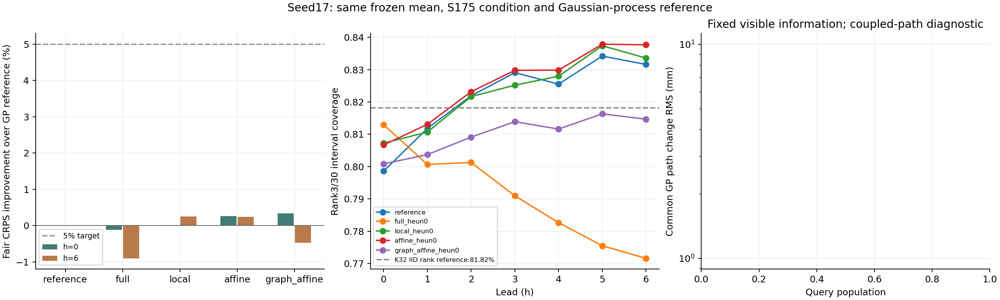

# GP参考轨迹扩散：机制与概率结果

seed17；同冻结TF3000均值、S175条件、训练Gaussian/copula。每新模型3000连续块。2020为已暴露开发日历，非完整年度或严格OOF。

| 模型 | R fair CRPS/mm | F6 fair CRPS/mm | 预报内部增量CRPS/mm | NFE | 新增参数 |
|---|---:|---:|---:|---:|---:|
| reference | 5.451039 | 7.779293 | 3.242046 | 0 | 0 |
| full_heun0 | 5.457593 | 7.849391 | 3.174995 | 39 | 45639 |
| full_ddim | 5.458927 | 7.871107 | 3.167663 | 40 | 45639 |
| local_heun0 | 5.450251 | 7.759337 | 3.154006 | 39 | 44692 |
| local_ddim | 5.451206 | 7.752441 | 3.141699 | 40 | 44692 |
| affine_heun0 | 5.436754 | 7.760257 | 3.150937 | 39 | 44944 |
| affine_ddim | 5.438048 | 7.752509 | 3.138557 | 40 | 44944 |
| graph_affine_heun0 | 5.432640 | 7.816289 | 3.146773 | 39 | 45259 |
| graph_affine_ddim | 5.436150 | 7.818700 | 3.136553 | 40 | 45259 |

R/F6为K32 IID成员fair CRPS，预报内部增量按同起点0–6h轨迹计算。Gaussian/Affine解析均值和解析CRPS在JSON单列；K32样本均值含有限成员误差。第3/30顺序统计量覆盖的连续校准IID参考为81.818%，不同于解析80%区间。

| 比较 | R差值95%区间/mm | F6差值95%区间/mm | 增量差值95%区间/mm |
|---|---|---|---|
| local_heun0_vs_affine_heun0 | [0.0072103626893115225, 0.0203163884796111] | [-0.011656409299360048, 0.008878771804699034] | [-0.0063180218991215845, 0.01285713733737792] |
| full_heun0_vs_affine_heun0 | [0.0020235255618672454, 0.04199487165098569] | [-0.06757577601576577, 0.2569447477932616] | [0.010226199884136178, 0.038652341568496215] |
| full_heun0_vs_graph_affine_heun0 | [0.008804057063424131, 0.040193579683834885] | [-0.08508916590092223, 0.15712155045710563] | [0.008573381888998522, 0.04928106158693098] |

Local/Affine逐查询运算，空间相关来自GP初值，表示GP噪声耦合的逐站轨迹过程。Full读取查询图；共同GP路径随查询集合变化的差异本身不等同于边际分布差异。

完整区间、来源哈希、解析Gaussian控制与查询路径结果见[process_summary.json](process_summary.json)。
