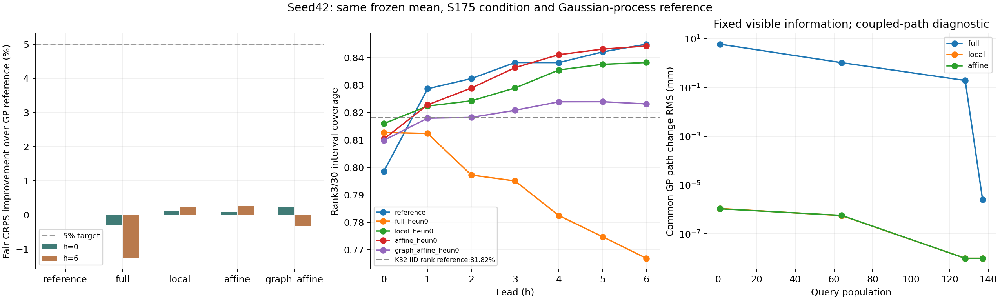

# GP参考轨迹扩散：机制与概率结果

seed42；同冻结TF3000均值、S175条件、训练Gaussian/copula。每新模型3000连续块。2020为已暴露开发日历，非完整年度或严格OOF。

| 模型 | R fair CRPS/mm | F6 fair CRPS/mm | 预报内部增量CRPS/mm | NFE | 新增参数 |
|---|---:|---:|---:|---:|---:|
| reference | 5.501693 | 7.817942 | 3.272429 | 0 | 0 |
| full_heun0 | 5.517525 | 7.917516 | 3.216223 | 39 | 45639 |
| full_ddim | 5.520144 | 7.941971 | 3.210907 | 40 | 45639 |
| local_heun0 | 5.496417 | 7.799677 | 3.165537 | 39 | 44692 |
| local_ddim | 5.495894 | 7.790207 | 3.150792 | 40 | 44692 |
| affine_heun0 | 5.496604 | 7.797156 | 3.177447 | 39 | 44944 |
| affine_ddim | 5.497643 | 7.785353 | 3.161654 | 40 | 44944 |
| graph_affine_heun0 | 5.489872 | 7.844561 | 3.186279 | 39 | 45259 |
| graph_affine_ddim | 5.491589 | 7.843050 | 3.172894 | 40 | 45259 |

R/F6为K32 IID成员fair CRPS，预报内部增量按同起点0–6h轨迹计算。Gaussian/Affine解析均值和解析CRPS在JSON单列；K32样本均值含有限成员误差。第3/30顺序统计量覆盖的连续校准IID参考为81.818%，不同于解析80%区间。

| 比较 | R差值95%区间/mm | F6差值95%区间/mm | 增量差值95%区间/mm |
|---|---|---|---|
| local_heun0_vs_affine_heun0 | [-0.007725720554520898, 0.0067330809416920046] | [-0.01049223013384699, 0.01381543427424887] | [-0.025487642685571334, -0.0011430459053779942] |
| full_heun0_vs_affine_heun0 | [0.00038378758875354816, 0.04425623781976106] | [0.008541914780071847, 0.22772068313435664] | [0.022504869571503903, 0.05447194518429911] |
| full_heun0_vs_graph_affine_heun0 | [0.0069609201016346935, 0.04795441711730232] | [-0.03142127662863621, 0.16299538675458883] | [0.015254110203746573, 0.044595045187609726] |

Local/Affine逐查询运算，空间相关来自GP初值，表示GP噪声耦合的逐站轨迹过程。Full读取查询图；共同GP路径随查询集合变化的差异本身不等同于边际分布差异。

完整区间、来源哈希、解析Gaussian控制与查询路径结果见[process_summary.json](process_summary.json)。
