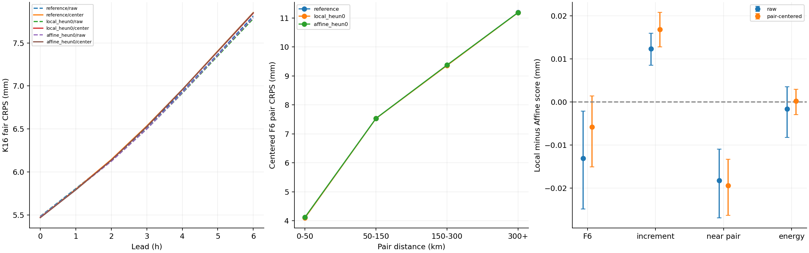

# 独立双场差分：严格均值保持诊断

冻结原32个IID成员，按事先锁定(k,k+16)配成16个互不重叠的独立输出成员。原模型前16成员为匹配K16描述对照。所有模型均执行相同变换；原模型和权重未改写。
Y=mu_base+(X-X')/sqrt(2)具有解析均值mu_base并保持原条件总体协方差；有限样本协方差不要求逐值相等。分布被对称化；四阶矩存在时，四阶累积量减半，不能认为原高阶分布保持不变。

| 模型 | 输出 | 当前CRPS/mm | F6 CRPS/mm | 增量CRPS/mm | 近邻F6差值CRPS/mm | energy/mm |
|---|---|---:|---:|---:|---:|---:|
| reference | raw16 | 5.484337 | 7.814597 | 3.224839 | 4.104474 | 8.552689 |
| reference | pair-center16 | 5.472554 | 7.854112 | 3.207860 | 4.108634 | 8.570248 |
| local_heun0 | raw16 | 5.481079 | 7.781898 | 3.148190 | 4.090482 | 8.531785 |
| local_heun0 | pair-center16 | 5.470996 | 7.845968 | 3.137609 | 4.105203 | 8.567707 |
| affine_heun0 | raw16 | 5.478413 | 7.795025 | 3.135830 | 4.108712 | 8.533452 |
| affine_heun0 | pair-center16 | 5.467674 | 7.851797 | 3.120817 | 4.124631 | 8.567479 |
| local_ddim | raw16 | 5.481316 | 7.773611 | 3.136437 | 4.066240 | 8.531175 |
| local_ddim | pair-center16 | 5.471230 | 7.838530 | 3.125401 | 4.081379 | 8.567539 |
| affine_ddim | raw16 | 5.479102 | 7.784872 | 3.126176 | 4.083186 | 8.531026 |
| affine_ddim | pair-center16 | 5.468395 | 7.842314 | 3.110683 | 4.099565 | 8.565442 |

| 比较 | 指标 | 改善 | 差值95%区间 |
|---|---|---:|---|
| local_heun0/independent_pair_centered16_vs_affine_heun0/independent_pair_centered16 | crps_h0 | -0.061% | [-0.0003395855409092491, 0.007599048188032451] |
| local_heun0/independent_pair_centered16_vs_affine_heun0/independent_pair_centered16 | crps_h6 | 0.074% | [-0.0150628128977962, 0.0013602807718920112] |
| local_heun0/independent_pair_centered16_vs_affine_heun0/independent_pair_centered16 | increment | -0.538% | [0.012740912081341984, 0.02074090293689586] |
| local_heun0/independent_pair_centered16_vs_affine_heun0/independent_pair_centered16 | pair_0-50_h6 | 0.471% | [-0.02628755822826122, -0.013334325458214934] |
| local_heun0/independent_pair_centered16_vs_affine_heun0/independent_pair_centered16 | energy | -0.003% | [-0.0029781418473192813, 0.0028989906321028646] |
| local_heun0/independent_pair_centered16_vs_affine_heun0/independent_pair_centered16 | event20_increase_brier | -0.036% | [-0.0002451197258894547, 0.0002907574064123405] |
| local_heun0/independent_pair_centered16_vs_affine_heun0/independent_pair_centered16 | event20_decrease_brier | -0.286% | [-0.00016981811103054228, 0.00043400051564731996] |
| local_heun0/independent_pair_centered16_vs_reference/independent_pair_centered16 | crps_h0 | 0.028% | [-0.0035131458945022267, 0.00040085348130248545] |
| local_heun0/independent_pair_centered16_vs_reference/independent_pair_centered16 | crps_h6 | 0.104% | [-0.014873023478231218, -0.003229835044357752] |
| local_heun0/independent_pair_centered16_vs_reference/independent_pair_centered16 | increment | 2.190% | [-0.08824659614623809, -0.05485081659787587] |
| local_heun0/independent_pair_centered16_vs_reference/independent_pair_centered16 | pair_0-50_h6 | 0.084% | [-0.00719728837395382, -0.00034482287609749734] |
| local_heun0/independent_pair_centered16_vs_reference/independent_pair_centered16 | energy | 0.030% | [-0.0050157020082555225, -0.0002992021858544748] |
| local_heun0/independent_pair_centered16_vs_reference/independent_pair_centered16 | event20_increase_brier | 0.483% | [-0.0005745940011494552, -0.0001102377947466801] |
| local_heun0/independent_pair_centered16_vs_reference/independent_pair_centered16 | event20_decrease_brier | 0.710% | [-0.000764749363227865, -0.00010911931311380518] |
| local_ddim/independent_pair_centered16_vs_affine_ddim/independent_pair_centered16 | crps_h0 | -0.052% | [-0.0013568722559104231, 0.007244402678333624] |
| local_ddim/independent_pair_centered16_vs_affine_ddim/independent_pair_centered16 | crps_h6 | 0.048% | [-0.012633096552327668, 0.0032419888458263407] |
| local_ddim/independent_pair_centered16_vs_affine_ddim/independent_pair_centered16 | increment | -0.473% | [0.010930282336539747, 0.01848435847480501] |
| local_ddim/independent_pair_centered16_vs_affine_ddim/independent_pair_centered16 | pair_0-50_h6 | 0.444% | [-0.024656229863298993, -0.012464489702577271] |
| local_ddim/independent_pair_centered16_vs_affine_ddim/independent_pair_centered16 | energy | -0.024% | [-0.001056561820012205, 0.004735235418243545] |
| local_ddim/independent_pair_centered16_vs_affine_ddim/independent_pair_centered16 | event20_increase_brier | 0.020% | [-0.0002723308521599587, 0.0002415873627908227] |
| local_ddim/independent_pair_centered16_vs_affine_ddim/independent_pair_centered16 | event20_decrease_brier | -0.250% | [-0.00018910291723488512, 0.00039946004581255793] |
| local_heun0/independent_pair_centered16_vs_local_heun0/raw_first16 | crps_h0 | 0.184% | [-0.03174157619264017, 0.005438820814895193] |
| local_heun0/independent_pair_centered16_vs_local_heun0/raw_first16 | crps_h6 | -0.823% | [0.018093343449454843, 0.12552458703915598] |
| local_heun0/independent_pair_centered16_vs_local_heun0/raw_first16 | increment | 0.336% | [-0.016751578216333583, -0.005303029252571155] |
| local_heun0/independent_pair_centered16_vs_local_heun0/raw_first16 | pair_0-50_h6 | -0.360% | [-6.0012427363463846e-05, 0.03022803038120809] |
| local_heun0/independent_pair_centered16_vs_local_heun0/raw_first16 | energy | -0.421% | [0.001135457204732457, 0.07411895856340586] |
| local_heun0/independent_pair_centered16_vs_local_heun0/raw_first16 | event20_increase_brier | 0.334% | [-0.0009070987051894616, 0.00034210146241081226] |
| local_heun0/independent_pair_centered16_vs_local_heun0/raw_first16 | event20_decrease_brier | -1.394% | [-4.343285175956116e-05, 0.0017542898341125913] |

## 解释边界

配对变换的解析点预测仍是约9.818mm的mu_base；K16样本均值有有限成员误差，不用它替换确定性点值。原始与变换的差异同时包含中心和高阶形状变化；只有同变换Local/Affine/G265比较才用于判断保留的非Gaussian价值。
所有fair评分使用实际K16。第2/15顺序统计量覆盖的连续IID参考为13/17，不能与K32第3/30参考混用。事件阈值沿用10/20/30mm，主20mm；全部有效起点评分。
2020主日历已暴露开发；没有新增日期验证、训练或读取确认/C/D标签。原32成员生成成本已付出，若线上获得32个新配对成员需64个原始场，成本应另计。两种子共享月份重采样，区间不包含训练种子总体不确定性。

完整所有距离/时效、事件、覆盖、fair均值MSE及哈希见[summary.json](summary.json)。
