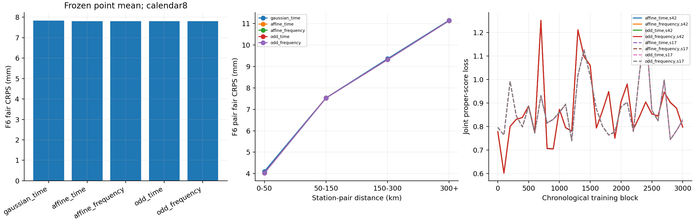

# 共享诱导创新流：固定均值的联合概率评价

2016–2019各3000连续块，种子42/17实际监督更新2999/3000；2020每月8日起72h三布局开发评价。Gaussian与四个流模型共享耦合GP/诱导噪声、冻结TF3000点均值和S175输入尺度。原残差strict_oof=false。

| 模型 | 当前CRPS/mm | 六小时CRPS/mm | 内部增量CRPS/mm | 近邻差值CRPS/mm | 全场energy/mm |
|---|---:|---:|---:|---:|---:|
| gaussian_time | 5.475677 | 7.838548 | 3.204036 | 4.100998 | 8.556632 |
| affine_time | 5.481342 | 7.809858 | 3.144597 | 4.025022 | 8.562304 |
| affine_frequency | 5.480530 | 7.808515 | 3.146538 | 4.025819 | 8.562841 |
| odd_time | 5.480938 | 7.810736 | 3.145982 | 4.024870 | 8.561844 |
| odd_frequency | 5.480833 | 7.811468 | 3.146954 | 4.025760 | 8.562403 |

## 配对比较

- affine_time_vs_gaussian_time：六小时CRPS收益0.366%，差值-0.028690mm，95%月份区间[-0.06575119835993123, -0.003036022883193722]。
- affine_frequency_vs_gaussian_time：六小时CRPS收益0.383%，差值-0.030032mm，95%月份区间[-0.07061441811037182, -0.00265135229510825]。
- odd_time_vs_gaussian_time：六小时CRPS收益0.355%，差值-0.027811mm，95%月份区间[-0.06448675349258122, -0.002192385333355698]。
- odd_frequency_vs_gaussian_time：六小时CRPS收益0.345%，差值-0.027079mm，95%月份区间[-0.06316565067707787, -0.002024141814752416]。
- odd_time_vs_affine_time：六小时CRPS收益-0.011%，差值0.000878mm，95%月份区间[-0.00013548713515680448, 0.0020180072579627497]。
- odd_frequency_vs_affine_frequency：六小时CRPS收益-0.038%，差值0.002953mm，95%月份区间[-0.000658545813805412, 0.007845853961879062]。
- affine_frequency_vs_affine_time：六小时CRPS收益0.017%，差值-0.001343mm，95%月份区间[-0.00570861623410404, 0.002385046103488533]。
- odd_frequency_vs_odd_time：六小时CRPS收益-0.009%，差值0.000732mm，95%月份区间[-0.00041123167426792363, 0.002187245148028749]。

点输出为冻结基础场的解析均值，不用有限成员平均值宣称RMSE改善。Affine保持Gaussian；odd保持中心对称，不能表达所有偏态分布。此实验用终端联合proper评分训练概率流，不是传统去噪score matching。
空间锚点不截断完整GP；训练Q32为几何/固定随机子集，评价Q137固定全人口。原Q128未来可用性选站、历史PWV筛选来源、末91块复用等限制继续保留，确认及原C/D标签未读取。

主指标为odd_frequency相对affine_frequency六小时fairCRPS；相对Gaussian及时间/频率、增量、站对、事件和地形分层分别归因。区间条件于两个种子及已暴露日期，未经多重探索校正。

[完整指标与来源](summary.json)
