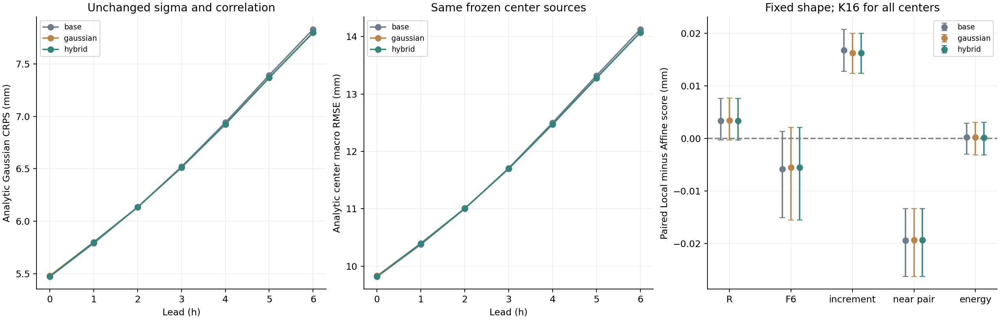

# 按时效中心消融：均值与概率结构分开

base为全时效TF3000中心；gaussian为全时效S175解析中心；hybrid为h0=TF3000、h1–h6=S175。规则及源清单在新成绩前冻结，不拟合开发门控或混合系数。A固定G265的K32随机残差，B固定独立配对后的K16随机残差；新操作均不训练网络。

| 阶段/日历 | 模型 | 中心 | 解析当前宏RMSE/mm | 解析F6宏RMSE/mm | 当前解析CRPS/mm | F6解析CRPS/mm | 增量fair CRPS/mm | 近邻F6差值CRPS/mm | energy/mm |
|---|---|---|---:|---:|---:|---:|---:|---:|---:|
| gaussian/8 | reference | base | 9.818254 | 14.127401 | 5.472498 | 7.829210 | 3.205329 | 4.105621 | 8.549818 |
| gaussian/8 | reference | gaussian | 9.832159 | 14.073517 | 5.481400 | 7.798081 | 3.222781 | 4.102779 | 8.539592 |
| gaussian/8 | reference | hybrid | 9.818254 | 14.073517 | 5.472498 | 7.798081 | 3.223670 | 4.102779 | 8.537792 |
| gaussian/15 | reference | base | 10.770502 | 16.393360 | 5.930543 | 8.974488 | 3.563417 | 4.597816 | 9.526134 |
| gaussian/15 | reference | gaussian | 10.785023 | 16.213485 | 5.938107 | 8.890366 | 3.577120 | 4.592926 | 9.483184 |
| gaussian/15 | reference | hybrid | 10.770502 | 16.213485 | 5.930543 | 8.890366 | 3.578544 | 4.592926 | 9.481933 |
| paired/8 | reference | base | 9.818254 | 14.127401 | NA | NA | 3.207860 | 4.108634 | 8.570248 |
| paired/8 | reference | gaussian | 9.832159 | 14.073517 | NA | NA | 3.225591 | 4.105720 | 8.562456 |
| paired/8 | reference | hybrid | 9.818254 | 14.073517 | NA | NA | 3.226337 | 4.105720 | 8.560617 |
| paired/8 | local_heun0 | base | 9.818254 | 14.127401 | NA | NA | 3.137609 | 4.105203 | 8.567707 |
| paired/8 | local_heun0 | gaussian | 9.832159 | 14.073517 | NA | NA | 3.157253 | 4.102316 | 8.559797 |
| paired/8 | local_heun0 | hybrid | 9.818254 | 14.073517 | NA | NA | 3.158023 | 4.102316 | 8.557950 |
| paired/8 | affine_heun0 | base | 9.818254 | 14.127401 | NA | NA | 3.120817 | 4.124631 | 8.567479 |
| paired/8 | affine_heun0 | gaussian | 9.832159 | 14.073517 | NA | NA | 3.140971 | 4.121670 | 8.559606 |
| paired/8 | affine_heun0 | hybrid | 9.818254 | 14.073517 | NA | NA | 3.141797 | 4.121670 | 8.557773 |

| 比较 | 指标 | 改善 | 差值95%区间 |
|---|---|---:|---|
| gaussian/calendar8/reference/hybrid_vs_reference/base | analytic_crps_h0 | 0.000% | [0.0, 0.0] |
| gaussian/calendar8/reference/hybrid_vs_reference/base | analytic_crps_h6 | 0.398% | [-0.07077552938539275, 0.004245095377577958] |
| gaussian/calendar8/reference/hybrid_vs_reference/base | crps_h0 | 0.000% | [0.0, 0.0] |
| gaussian/calendar8/reference/hybrid_vs_reference/base | crps_h6 | 0.375% | [-0.06994256801137422, 0.00664897019006152] |
| gaussian/calendar8/reference/hybrid_vs_reference/base | increment | -0.572% | [0.013199227600488346, 0.02300163272600811] |
| gaussian/calendar8/reference/hybrid_vs_reference/base | pair_0-50_h6 | 0.069% | [-0.019121935885337976, 0.012943613299760173] |
| gaussian/calendar8/reference/hybrid_vs_reference/base | energy | 0.141% | [-0.036011497435172186, 0.012687657485707129] |
| gaussian/calendar8/reference/hybrid_vs_reference/base | event20_increase_brier | -0.226% | [-0.00027327297559661583, 0.0006446386224503402] |
| gaussian/calendar8/reference/hybrid_vs_reference/base | event20_decrease_brier | 0.976% | [-0.0013157976385653747, 1.4794364684889478e-06] |
| gaussian/calendar8/reference/hybrid_vs_reference/gaussian | analytic_crps_h0 | 0.162% | [-0.022681982722382, 0.0027208012817219246] |
| gaussian/calendar8/reference/hybrid_vs_reference/gaussian | analytic_crps_h6 | 0.000% | [0.0, 0.0] |
| gaussian/calendar8/reference/hybrid_vs_reference/gaussian | crps_h0 | 0.162% | [-0.022418497684185756, 0.0025445925122166337] |
| gaussian/calendar8/reference/hybrid_vs_reference/gaussian | crps_h6 | 0.000% | [0.0, 0.0] |
| gaussian/calendar8/reference/hybrid_vs_reference/gaussian | increment | -0.028% | [0.00046254675050357464, 0.001316986322841072] |
| gaussian/calendar8/reference/hybrid_vs_reference/gaussian | pair_0-50_h6 | 0.000% | [0.0, 0.0] |
| gaussian/calendar8/reference/hybrid_vs_reference/gaussian | energy | 0.021% | [-0.003905360399205623, -0.0002333008319017034] |
| gaussian/calendar8/reference/hybrid_vs_reference/gaussian | event20_increase_brier | 0.366% | [-0.0004729824064631561, -6.943886072571616e-05] |
| gaussian/calendar8/reference/hybrid_vs_reference/gaussian | event20_decrease_brier | -0.385% | [8.809966443298222e-05, 0.0003949945251701815] |
| gaussian/calendar15/reference/hybrid_vs_reference/base | analytic_crps_h0 | 0.000% | [0.0, 0.0] |
| gaussian/calendar15/reference/hybrid_vs_reference/base | analytic_crps_h6 | 0.937% | [-0.15486685270024272, -0.03674698194620851] |
| gaussian/calendar15/reference/hybrid_vs_reference/base | crps_h0 | 0.000% | [0.0, 0.0] |
| gaussian/calendar15/reference/hybrid_vs_reference/base | crps_h6 | 0.950% | [-0.15681441941142696, -0.03715073684178058] |
| gaussian/calendar15/reference/hybrid_vs_reference/base | increment | -0.425% | [0.010579594875089925, 0.019951115868039895] |
| gaussian/calendar15/reference/hybrid_vs_reference/base | pair_0-50_h6 | 0.106% | [-0.019312811246503706, 0.009314026134180258] |
| gaussian/calendar15/reference/hybrid_vs_reference/base | energy | 0.464% | [-0.07567712867586106, -0.02015987387737243] |
| gaussian/calendar15/reference/hybrid_vs_reference/base | event20_increase_brier | 0.219% | [-0.0008189519539756201, 0.0004243424717122286] |
| gaussian/calendar15/reference/hybrid_vs_reference/base | event20_decrease_brier | 1.996% | [-0.003371925471440938, -0.00045431724132993193] |
| gaussian/calendar15/reference/hybrid_vs_reference/gaussian | analytic_crps_h0 | 0.127% | [-0.017100787868262052, 0.00160770692302741] |
| gaussian/calendar15/reference/hybrid_vs_reference/gaussian | analytic_crps_h6 | 0.000% | [0.0, 0.0] |
| gaussian/calendar15/reference/hybrid_vs_reference/gaussian | crps_h0 | 0.129% | [-0.017247623809130853, 0.0016502020897577877] |
| gaussian/calendar15/reference/hybrid_vs_reference/gaussian | crps_h6 | 0.000% | [0.0, 0.0] |
| gaussian/calendar15/reference/hybrid_vs_reference/gaussian | increment | -0.040% | [0.00027157699300258054, 0.0027510093689359014] |
| gaussian/calendar15/reference/hybrid_vs_reference/gaussian | pair_0-50_h6 | 0.000% | [0.0, 0.0] |
| gaussian/calendar15/reference/hybrid_vs_reference/gaussian | energy | 0.013% | [-0.002483473188348564, -1.9948381562108995e-05] |
| gaussian/calendar15/reference/hybrid_vs_reference/gaussian | event20_increase_brier | 0.280% | [-0.00041494223987109034, -6.557463698098614e-05] |
| gaussian/calendar15/reference/hybrid_vs_reference/gaussian | event20_decrease_brier | -0.394% | [-2.3080323020947267e-05, 0.0007031278741853368] |
| paired/calendar8/local_heun0/hybrid_vs_affine_heun0/hybrid | crps_h0 | -0.061% | [-0.0003395855409092491, 0.007599048188032451] |
| paired/calendar8/local_heun0/hybrid_vs_affine_heun0/hybrid | crps_h6 | 0.070% | [-0.015510238348394228, 0.0021072997449651447] |
| paired/calendar8/local_heun0/hybrid_vs_affine_heun0/hybrid | increment | -0.516% | [0.01233711524059774, 0.019965534763610276] |
| paired/calendar8/local_heun0/hybrid_vs_affine_heun0/hybrid | pair_0-50_h6 | 0.470% | [-0.026229962364512135, -0.013356837326194701] |
| paired/calendar8/local_heun0/hybrid_vs_affine_heun0/hybrid | energy | -0.002% | [-0.0031685581640461514, 0.003032953462894055] |
| paired/calendar8/local_heun0/hybrid_vs_affine_heun0/hybrid | event20_increase_brier | 0.097% | [-0.0003406121944505876, 0.00021297575352910523] |
| paired/calendar8/local_heun0/hybrid_vs_affine_heun0/hybrid | event20_decrease_brier | -0.441% | [-4.220416941776956e-05, 0.0004994770522366615] |
| paired/calendar8/local_heun0/hybrid_vs_local_heun0/base | crps_h0 | 0.000% | [0.0, 0.0] |
| paired/calendar8/local_heun0/hybrid_vs_local_heun0/base | crps_h6 | 0.350% | [-0.06846955336023157, 0.009151941347386618] |
| paired/calendar8/local_heun0/hybrid_vs_local_heun0/base | increment | -0.651% | [0.014319200039005777, 0.02592950254526649] |
| paired/calendar8/local_heun0/hybrid_vs_local_heun0/base | pair_0-50_h6 | 0.070% | [-0.019180048334991717, 0.013108985659292792] |
| paired/calendar8/local_heun0/hybrid_vs_local_heun0/base | energy | 0.114% | [-0.03381639555275112, 0.015561575857716246] |
| paired/calendar8/local_heun0/hybrid_vs_local_heun0/base | event20_increase_brier | -0.145% | [-0.00040690963844522003, 0.0006256260583275639] |
| paired/calendar8/local_heun0/hybrid_vs_local_heun0/base | event20_decrease_brier | 0.837% | [-0.0011567283416290442, 1.5703517507450703e-05] |

## 解释

同一模型、同一阶段中，每个成员的随机残差逐值不变，因此中心比较不再混入形状或噪声变化。解析中心由可见条件的冻结模型决定，truth只参与评分。给定相同可见条件时，随机残差的协方差保持；站对均值和跨lead增量均值允许改变，跨日期聚合波动也可随中心变化。
配对Local/Affine共享同一解析中心，其点值RMSE相同；不同分布只比较概率评分。K16/K32样本均值的有限成员误差另存JSON，不能当解析均值排名。解析CRPS仅适用于Gaussian阶段，配对非Gaussian阶段记NA。
主2020每月8–10日，补充15–17日均已开发暴露，三布局137查询。缺标签按相同mask计分；确认及原C/D标签未读取。主事件20mm，10/20/30mm及两方向全部见JSON。
点值宏RMSE与概率分数使用各自匹配统计量；点值月份区间保留站/布局结构。所有区间条件于固定两种子，未经多重比较校正。

完整源哈希、三个中心所有时效、DDIM复核、事件、覆盖和区间见[summary.json](summary.json)。
