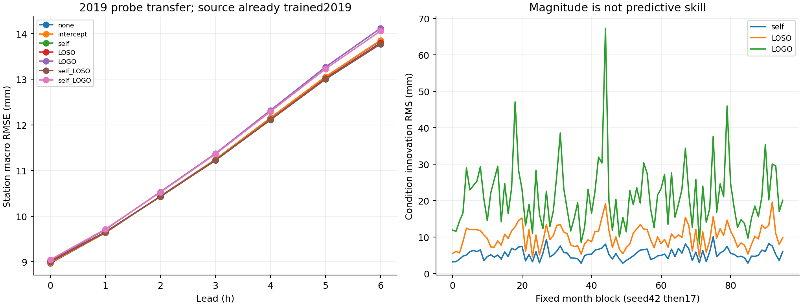

# 留站创新面板：尺度与可预测信号分开检验

两种子各48个固定月块，每块连续12h；2016–2018拟合线性探针，2019检验探针迁移。来源p14/TF已拟合2016–2019，因此不是基础模型独立时间留出。原查询由缓存既有规则确定；本轮没有新神经训练或2020评价。

| 探针 | 当前站宏RMSE/mm | 六小时站宏RMSE/mm | 当前microRMSE/mm | 六小时microRMSE/mm |
|---|---:|---:|---:|---:|
| none | 8.966562 | 13.842908 | 10.021148 | 14.795930 |
| intercept | 8.979617 | 13.855827 | 10.025638 | 14.805849 |
| self | 9.019324 | 13.779104 | 10.052358 | 14.730750 |
| LOSO | 8.996828 | 13.798103 | 10.035574 | 14.732175 |
| LOGO | 9.024609 | 14.116357 | 10.053728 | 15.102489 |
| self_LOSO | 9.015798 | 13.770374 | 10.057569 | 14.724665 |
| self_LOGO | 9.044619 | 14.057666 | 10.067383 | 15.052466 |

## 配对区间

- intercept_vs_none 当前/F6站宏差值95%共享月份区间：[[-0.0050950368306017955, 0.03422741236631967], [-0.10304230676741385, 0.13290067972193026]]mm。
- intercept_vs_self 当前/F6站宏差值95%共享月份区间：[[-0.05886794324603532, -0.009771654161487823], [0.007987976122599784, 0.15138721392408047]]mm。
- self_vs_none 当前/F6站宏差值95%共享月份区间：[[0.010270849911698576, 0.08520968411081592], [-0.14953302730857074, 0.018613508269499368]]mm。
- LOSO_vs_none 当前/F6站宏差值95%共享月份区间：[[0.003927244726980961, 0.05324655094446862], [-0.16063318044600447, 0.0808551615740571]]mm。
- LOSO_vs_self 当前/F6站宏差值95%共享月份区间：[[-0.04087867698850114, 0.0006009059986915548], [-0.0418442010616785, 0.09627810153030356]]mm。
- LOGO_vs_none 当前/F6站宏差值95%共享月份区间：[[0.018452570180399565, 0.0945007820325058], [-0.05663369144372665, 0.5580338517112965]]mm。
- LOGO_vs_self 当前/F6站宏差值95%共享月份区间：[[-0.021485928067826697, 0.03975431306265842], [-0.007293655353061278, 0.6252678144217433]]mm。
- self_LOSO_vs_none 当前/F6站宏差值95%共享月份区间：[[0.006108744228166163, 0.07690148621288109], [-0.17582653173989918, 0.024129709319760734]]mm。
- self_LOSO_vs_self 当前/F6站宏差值95%共享月份区间：[[-0.019107031056396617, 0.009612031018264133], [-0.06061617748181072, 0.04379258272140628]]mm。
- self_LOGO_vs_none 当前/F6站宏差值95%共享月份区间：[[0.023893651892135416, 0.12217976523342353], [-0.10835203859292024, 0.4699582423418175]]mm。
- self_LOGO_vs_self 当前/F6站宏差值95%共享月份区间：[[0.00271408293602875, 0.05251533168074103], [-0.04603461383262793, 0.5393649664392918]]mm。

差值为前者减后者，负为误差减少。区间共享两种子和模型的12个月抽样，条件于固定两种子且未经多重比较校正；地区/季节分层为MSE，稀疏季节空抽样区间记NA。完整系数、训练归一化、来源哈希及分层见JSON。
留出在全部背景历史GNSS/T/P上生效，单块有真实扰动不变性核验；前向留站不等于训练折外，拼接LOSO不自动形成统一Gaussian误差过程。旧未来可用性选目标与历史PWV筛选限制保留，确认及原C/D标签未读。

[完整指标与来源](summary.json)
