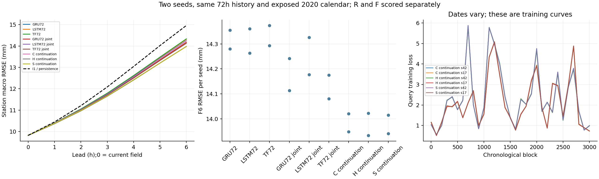

# 同历史逐站时间编码：双种子配对结果

2016–2019连续训练；2020抽样开发日历、137注册查询站。每模型同72h有效历史、同站点抽样、同3000块。raw与EMA分别报告。C/H/S如列出则均从相同3000步源继续3000步。

| 模型 | R/mm | F6/mm | R小时增量/mm | 参数 |
|---|---:|---:|---:|---:|
| gru72_last | 9.821700 | 14.317728 | 5.524158 | 86299 |
| gru72_ema | 9.824363 | 14.386594 | 5.531467 | 86299 |
| lstm72_last | 9.819442 | 14.312099 | 5.526112 | 102939 |
| lstm72_ema | 9.822176 | 14.383512 | 5.533611 | 102939 |
| transformer72_last | 9.820257 | 14.333602 | 5.530801 | 103323 |
| transformer72_ema | 9.821922 | 14.406148 | 5.537539 | 103323 |
| gru72_physics_aux_last | 9.821917 | 14.177009 | 5.543350 | 89809 |
| gru72_physics_aux_ema | 9.831600 | 14.251491 | 5.557959 | 89809 |
| lstm72_physics_aux_last | 9.817636 | 14.251512 | 5.540765 | 106449 |
| lstm72_physics_aux_ema | 9.826906 | 14.303738 | 5.553549 | 106449 |
| transformer72_physics_aux_last | 9.818254 | 14.127401 | 5.542310 | 106833 |
| transformer72_physics_aux_ema | 9.826697 | 14.239482 | 5.550031 | 106833 |
| C_v2_last | 9.827325 | 13.983685 | 5.535544 | 106833 |
| C_v2_ema | 9.833315 | 14.001466 | 5.538593 | 106833 |
| H_v2_last | 9.811031 | 13.977705 | 5.545044 | 108393 |
| H_v2_ema | 9.817113 | 13.994826 | 5.550050 | 108393 |
| S_v2_last | 9.827246 | 13.977733 | 5.535277 | 111075 |
| S_v2_ema | 9.833271 | 13.999196 | 5.538462 | 111075 |

| 配对比较 | R差值95%区间/mm | F6差值95%区间/mm |
|---|---|---|
| gru72_physics_aux_last_vs_gru72_last | [-0.02217745928213999, 0.028984355166445114] | [-0.21043633857647884, -0.06318732303185559] |
| lstm72_physics_aux_last_vs_lstm72_last | [-0.028638330809231106, 0.031360956405114444] | [-0.14636674946041167, 0.03059484357817061] |
| transformer72_physics_aux_last_vs_transformer72_last | [-0.026075431848372466, 0.028507169794110637] | [-0.2886954601645264, -0.11013022344976654] |
| transformer72_physics_aux_last_vs_gru72_physics_aux_last | [-0.01610888948284952, 0.010156674933159625] | [-0.09428660781854008, -0.002652610202705114] |
| transformer72_physics_aux_last_vs_lstm72_physics_aux_last | [-0.01383467569188701, 0.01751702900548005] | [-0.23470101835217322, -0.034178229125814696] |
| H_v2_last_vs_C_v2_last | [-0.026154558913125035, -0.0046995639503924404] | [-0.022655604683072726, 0.011523257050312626] |
| S_v2_last_vs_C_v2_last | [-0.00039938218603281507, 0.00027151521179478137] | [-0.008950186818654959, -0.002751721393682251] |
| C_v2_last_vs_source | [0.0025841681975690813, 0.016345938842813632] | [-0.24930834686247555, -0.061476713623438296] |

区间共享同月份抽样；它衡量已暴露开发日历的比较，模型选择未经多重比较校正。Transformer概率候选沿用seed42预先冻结的架构/last政策，seed17结果用于复核。

全部时效、逐种子结果、训练耗时与来源哈希见[paired_mean_summary.json](paired_mean_summary.json)。
