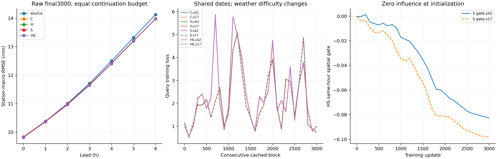

# H＋S组合：同起点同预算的真实训练结果

2016–2019原缓存连续块顺序；源Transformer step3000，C/H/S/HS各新增3000。raw为主，EMA并列；源3000另列预算参考。2020每月8–10日三布局、137注册查询为已暴露开发；不代表独立全年。
H为中心化创新读出，S为同刻空间消息。HS两分支分别匹配原单臂初始化并严格继承同一非零源；旧AdamW/RNG与同一cosine周期保留。

| 模型 | 权重 | 当前宏RMSE/mm | F6宏RMSE/mm | 当前小时增量宏RMSE/mm | 同起点内部增量microRMSE/mm | 参数 |
|---|---|---:|---:|---:|---:|---:|
| source | last | 9.818254 | 14.127401 | 5.542310 | 5.816455 | 106833 |
| source | ema | 9.826697 | 14.239482 | 5.550031 | 5.823628 | 106833 |
| C | last | 9.827325 | 13.983685 | 5.535544 | 5.802974 | 106833 |
| C | ema | 9.833315 | 14.001466 | 5.538593 | 5.805421 | 106833 |
| H | last | 9.811031 | 13.977705 | 5.545044 | 5.803134 | 108393 |
| H | ema | 9.817113 | 13.994826 | 5.550050 | 5.805539 | 108393 |
| S | last | 9.827246 | 13.977733 | 5.535277 | 5.802649 | 111075 |
| S | ema | 9.833271 | 13.999196 | 5.538462 | 5.805278 | 111075 |
| HS | last | 9.811297 | 13.972726 | 5.545337 | 5.802818 | 112635 |
| HS | ema | 9.817235 | 13.993073 | 5.550115 | 5.805403 | 112635 |

| 比较 | 当前差值95%区间/mm | F6差值95%区间/mm | 当前增量差值95%区间/mm |
|---|---|---|---|
| HS_last_vs_source_last | [-0.02001692285313057, 0.010581248015219329] | [-0.25297161602941387, -0.07432758689891683] | [-0.006495611166133397, 0.016903555601754272] |
| HS_last_vs_C_last | [-0.025952934369505208, -0.004207915859929436] | [-0.02692169708404788, 0.006335953134515185] | [0.0011195500873155463, 0.022285523383117144] |
| HS_last_vs_H_last | [2.1641534731164928e-05, 0.0005143843936117329] | [-0.007706401914072814, -0.002249316851672134] | [0.00016139556944441135, 0.00039979662299400865] |
| HS_last_vs_S_last | [-0.026155133110630134, -0.004102078110723544] | [-0.021328786121063946, 0.012228427366634072] | [0.001340135776725382, 0.022556309524649782] |
| HS_ema_vs_source_ema | [-0.028008281366631936, 0.014343132219667811] | [-0.34717518797510744, -0.15562324294956392] | [-0.010158020485584118, 0.013137188912029191] |
| HS_ema_vs_C_ema | [-0.02566164143607934, -0.003804769735984965] | [-0.022293447321955727, 0.006097839553616681] | [0.002913623192673476, 0.023050588734884702] |
| HS_ema_vs_H_ema | [-5.3813050084894334e-06, 0.00023319521885416527] | [-0.002674775040917332, -0.000764267125240137] | [6.598869068596969e-06, 0.0001200251521518591] |
| HS_ema_vs_S_ema | [-0.025703513259315615, -0.003698839700787341] | [-0.019857379880111603, 0.00848101879737676] | [0.0030842192357063204, 0.023185378185709576] |

组合交互以HS−H−S＋C的MSE差描述，单位mm²，完整值和月份区间见JSON；它是预测风险的统计交互，不能单独排除参数容量等替代解释。距离、高程、海岸、无量纲地形起伏编码、四季及站对分层以micro MSE另存，不与总体station macro RMSE混用。季节/稀有分层若共同月份重采样产生空总体，则保留描述值、区间记NA，不删除空抽样或填零。空分层不作排名。
所有raw/EMA均与final3000 checkpoint逐tensor核验，导出权重/协议/embedding及评价来源、几何与条件距离哈希绑定。点值不从有限成员概率均值估计。
缓存末尾91块顺序复用但不跨回绕拼历史；目标站未来轨迹可用性筛选与strict_oof=false限制保留。确认及原C/D标签未读取。月份区间条件于两个固定种子，未经多重比较校正。

完整分层、逐站、来源与交互风险见[summary.json](summary.json)。
