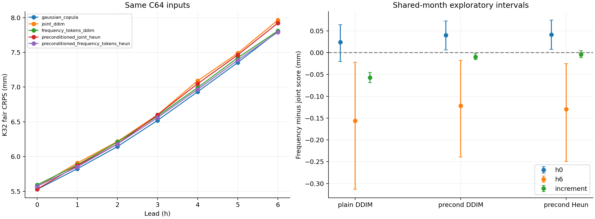

# 时空域与频域扩散：同C64条件双种子3000步

七组训练均完成双种子各3000连续块；Gaussian另有同权重copula推断，预条件两组各有DDIM/Heun采样器。2020主日历已暴露开发，非全年、非严格OOF。
概率条件均为64维冻结Transformer状态。频域使用全部七个时间DCT系数、完整空间图谱响应及频带卷积；未截断频带。其图基依赖查询人口，尚不是查询集合一致的连续潜场。

| 模型 | 新训练参数 | 冻结Gaussian参数 | 当前CRPS/mm | F6 CRPS/mm | 内部增量CRPS/mm |
|---|---:|---:|---:|---:|---:|
| gaussian_ddim | 5070 | 0 | 5.527818 | 7.804282 | 4.450504 |
| gaussian_copula | 5070 | 0 | 5.528067 | 7.799795 | 3.188189 |
| spatial_ddim | 38535 | 0 | 5.598376 | 7.924760 | 3.146192 |
| graph_ddim | 38535 | 0 | 5.597843 | 7.888989 | 3.161619 |
| joint_ddim | 38535 | 0 | 5.567254 | 7.964882 | 3.181292 |
| frequency_tokens_ddim | 38401 | 0 | 5.591396 | 7.808537 | 3.123919 |
| preconditioned_joint_ddim | 38535 | 5070 | 5.542362 | 7.927942 | 3.165444 |
| preconditioned_joint_heun | 38535 | 5070 | 5.531261 | 7.921449 | 3.167926 |
| preconditioned_frequency_tokens_ddim | 38401 | 5070 | 5.582476 | 7.806448 | 3.155682 |
| preconditioned_frequency_tokens_heun | 38401 | 5070 | 5.572720 | 7.791508 | 3.163493 |

| 比较 | 指标 | 改善 | 差值95%区间/mm |
|---|---|---:|---|
| frequency_tokens_ddim_vs_gaussian_copula | h0 | -1.146% | [0.03199391007289878, 0.09036830126811245] |
| frequency_tokens_ddim_vs_gaussian_copula | h6 | -0.112% | [-0.04038124407816288, 0.05395944569869927] |
| frequency_tokens_ddim_vs_gaussian_copula | increment | 2.016% | [-0.08052274960997635, -0.04866996250989801] |
| preconditioned_frequency_tokens_ddim_vs_gaussian_copula | h0 | -0.984% | [0.023631121633278702, 0.08415268509650235] |
| preconditioned_frequency_tokens_ddim_vs_gaussian_copula | h6 | -0.085% | [-0.032538335160495965, 0.047611402699553156] |
| preconditioned_frequency_tokens_ddim_vs_gaussian_copula | increment | 1.020% | [-0.04399069850936604, -0.02091662470189351] |
| preconditioned_frequency_tokens_heun_vs_gaussian_copula | h0 | -0.808% | [0.011836222056574947, 0.07523428883260108] |
| preconditioned_frequency_tokens_heun_vs_gaussian_copula | h6 | 0.106% | [-0.04442335805871663, 0.029239628729446316] |
| preconditioned_frequency_tokens_heun_vs_gaussian_copula | increment | 0.775% | [-0.03365746813333227, -0.015576449602129661] |
| frequency_tokens_ddim_vs_joint_ddim | h0 | -0.434% | [-0.019991574444879253, 0.06429305575477359] |
| frequency_tokens_ddim_vs_joint_ddim | h6 | 1.963% | [-0.3134049023721007, -0.021811783081915944] |
| frequency_tokens_ddim_vs_joint_ddim | increment | 1.803% | [-0.06885417250870446, -0.045626264640707764] |
| frequency_tokens_ddim_vs_graph_ddim | h0 | 0.115% | [-0.056896091886824395, 0.03939285691385472] |
| frequency_tokens_ddim_vs_graph_ddim | h6 | 1.020% | [-0.19446752470050077, 0.027436860202799833] |
| frequency_tokens_ddim_vs_graph_ddim | increment | 1.192% | [-0.04393853557596711, -0.031231420446985465] |
| preconditioned_frequency_tokens_ddim_vs_preconditioned_joint_ddim | h0 | -0.724% | [0.006197506164605996, 0.07261506430372679] |
| preconditioned_frequency_tokens_ddim_vs_preconditioned_joint_ddim | h6 | 1.532% | [-0.23948560091153667, -0.017840355703584387] |
| preconditioned_frequency_tokens_ddim_vs_preconditioned_joint_ddim | increment | 0.308% | [-0.015865729386604664, -0.0024989590455360595] |
| preconditioned_frequency_tokens_heun_vs_preconditioned_joint_heun | h0 | -0.750% | [0.007536967066455992, 0.0746972575373603] |
| preconditioned_frequency_tokens_heun_vs_preconditioned_joint_heun | h6 | 1.640% | [-0.2491142514582323, -0.02502487915698692] |
| preconditioned_frequency_tokens_heun_vs_preconditioned_joint_heun | increment | 0.140% | [-0.011553288852521236, 0.004108228312654858] |

全部模型最后权重已与checkpoint3000逐tensor核对；预测、truth、冻结均值及计分来源已验收。旧协议缺少显式条件维度时，另由权重输入维度核验C64。部分旧计分源码版本不同，原始源码哈希保留，并从实际成员独立复算。频域original/commuted后端据实际来源记录，不混写。频域与joint参数约38.4k/38.5k，预条件组额外冻结5070参数Gaussian。Gaussian本体5070参数，并非容量匹配对照。
主要判断应比较同信息、相近容量的频域与joint，同时检查Gaussian copula参考。新S175/G265使用更丰富的直连天气信息，其差异不能归因为频域。内部增量收益也不能从独立Gaussian单独推断为非Gaussian优势。
当前场点预测仍使用约9.818mm基础场；K32样本均值含有限采样和分布中心修正。月份区间条件于固定两种子，未经多重比较校正。

完整来源和对照见[summary.json](summary.json)。
