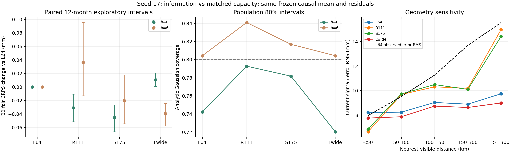

# 概率条件的信息直连与容量对照

seed17，各3000连续块；L64复用原Gaussian。均值源相同，概率头另有条件均值修正。2020主日历为已暴露开发评价。

| 条件 | 参数 | R解析CRPS/mm | F6解析CRPS/mm | R分布均值RMSE/mm | F6分布均值RMSE/mm | R解析80%覆盖 | F6解析80%覆盖 |
|---|---:|---:|---:|---:|---:|---:|---:|
| L64 | 5070 | 5.500485 | 7.800271 | 9.787587 | 14.067166 | 74.22% | 80.44% |
| R111 | 8078 | 5.470170 | 7.837106 | 9.793664 | 14.071932 | 79.28% | 84.10% |
| S175 | 12174 | 5.455738 | 7.779938 | 9.798102 | 14.063004 | 78.18% | 81.69% |
| Lwide | 12180 | 5.510940 | 7.761092 | 9.791548 | 14.023303 | 72.04% | 80.44% |

S175与Lwide分别为12174/12180参数。其R的K32 fair CRPS差值95%月份配对区间为[-0.08162165701979221, -0.03282357449143925] mm，F6为[-0.012684192894179458, 0.059192782329759094] mm。区间保留每个月实际有效标签数；它衡量本日历的开发比较，不代表完整年度或盲测。

直接信息通道主要改善当前场概率校准；全局CRPS收益尚未达到预先约定的5%门槛，未来预报分开判断。150–300km仍有解析覆盖缺口，不能把条件向量增加视为瓶颈已经解决。

全部时效、来源/权重哈希、距离尺度与配对区间见[context_summary.json](context_summary.json)。
