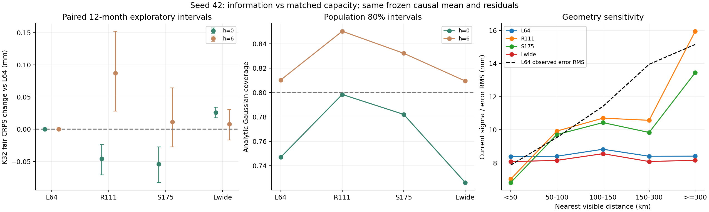

# 概率条件的信息直连与容量对照

seed42，各3000连续块；L64复用原Gaussian。均值源相同，概率头另有条件均值修正。2020主日历为已暴露开发评价。

| 条件 | 参数 | R解析CRPS/mm | F6解析CRPS/mm | R分布均值RMSE/mm | F6分布均值RMSE/mm | R解析80%覆盖 | F6解析80%覆盖 |
|---|---:|---:|---:|---:|---:|---:|---:|
| L64 | 5070 | 5.560753 | 7.805368 | 9.851468 | 14.075032 | 74.70% | 81.04% |
| R111 | 8078 | 5.515275 | 7.892545 | 9.876748 | 14.163372 | 79.85% | 85.04% |
| S175 | 12174 | 5.507062 | 7.816225 | 9.866216 | 14.084030 | 78.22% | 83.23% |
| Lwide | 12180 | 5.586853 | 7.813059 | 9.861783 | 14.084836 | 72.63% | 80.95% |

S175与Lwide分别为12174/12180参数。其R的K32 fair CRPS差值95%月份配对区间为[-0.10516551972231314, -0.05668399189252882] mm，F6为[-0.036545197173747934, 0.056080621046629794] mm。区间保留每个月实际有效标签数；它衡量本日历的开发比较，不代表完整年度或盲测。

直接信息通道主要改善当前场概率校准；全局CRPS收益尚未达到预先约定的5%门槛，未来预报分开判断。150–300km仍有解析覆盖缺口，不能把条件向量增加视为瓶颈已经解决。

全部时效、来源/权重哈希、距离尺度与配对区间见[context_summary.json](context_summary.json)。
