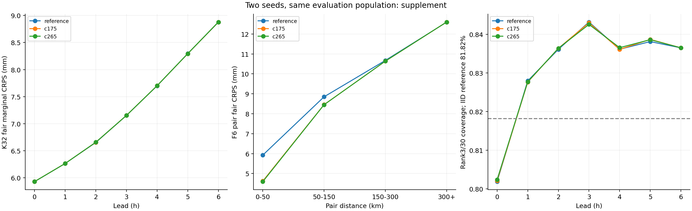

# 冻结天气GP：补充日期双种子验证

2016–2019训练；2020抽样日期为开发暴露。双种子、K32 IID成员；不代表全年或严格折外。

| 模型 | 当前CRPS/mm | F6 CRPS/mm | 内部增量CRPS/mm | 0–50km F6差值CRPS/mm | energy/mm |
|---|---:|---:|---:|---:|---:|
| reference | 5.930598 | 8.875097 | 3.624096 | 5.923566 | 9.492801 |
| c175 | 5.932075 | 8.877085 | 3.623127 | 4.620036 | 9.482958 |
| c265 | 5.932129 | 8.878953 | 3.577120 | 4.592926 | 9.483184 |

| 比较 | 指标 | 改善 | 差值95%区间 |
|---|---|---:|---|
| c175_vs_reference | crps_h0 | -0.025% | [-0.0021204453089940798, 0.005057861317195229] |
| c175_vs_reference | crps_h6 | -0.022% | [-0.009050918760597623, 0.013361341867148721] |
| c175_vs_reference | increment | 0.027% | [-0.0026505250934602863, 0.001481317218040303] |
| c175_vs_reference | pair_0-50_h6 | 22.006% | [-1.7310602503800645, -1.043167995597554] |
| c175_vs_reference | energy | 0.104% | [-0.014239534867832639, -0.004825854858953365] |
| c175_vs_reference | analytic_pair_0-50_h6 | 21.949% | [-1.7258793613163155, -1.0410239632518115] |
| c265_vs_reference | crps_h0 | -0.026% | [-0.0022081401044105305, 0.005274931118941923] |
| c265_vs_reference | crps_h6 | -0.043% | [-0.007908163942710806, 0.016165794435971794] |
| c265_vs_reference | increment | 1.296% | [-0.10050384642221007, -0.0008173585008306218] |
| c265_vs_reference | pair_0-50_h6 | 22.464% | [-1.7565965298857917, -1.0689306470310664] |
| c265_vs_reference | energy | 0.101% | [-0.014468724467148258, -0.0037962847069248906] |
| c265_vs_reference | analytic_pair_0-50_h6 | 22.419% | [-1.7506597614499613, -1.0669108221355257] |
| c265_vs_c175 | crps_h0 | -0.001% | [-0.0008253141305588622, 0.001058933147839269] |
| c265_vs_c175 | crps_h6 | -0.021% | [0.0002357688448020123, 0.0036850658999948915] |
| c265_vs_c175 | increment | 1.270% | [-0.10100957761166438, 0.0013460093814213017] |
| c265_vs_c175 | pair_0-50_h6 | 0.587% | [-0.039743865798056055, -0.01572063480677779] |
| c265_vs_c175 | energy | -0.002% | [-0.0015494590996325403, 0.0019227990155308424] |
| c265_vs_c175 | analytic_pair_0-50_h6 | 0.603% | [-0.040467764643836314, -0.01659324610043468] |

## 均值与作用范围

概率分数表使用同一总体上的K32 fair估计；Gaussian解析分数及四距离档、覆盖、逐月和来源另列JSON。DDIM为边际及增量采样器复核，未另做全场joint评分，表中NA表示未评估。
均值诊断以(barY-y)^2-s²/K估计条件均值MSE；与确定性基础场相减，单位mm²。它可逐点为负，不等于生成样本自身RMSE，也不宜开方后声称精确RMSE。

| 模型 | 当前均值MSE相对基础场/mm² | 95%区间 | F6差值/mm² | 95%区间 |
|---|---:|---|---:|---|
| reference | -0.037107 | [-0.6462606301990665, 0.4649357575084757] | -6.919954 | [-12.823361711049317, -3.1393955982804176] |
| c175 | 0.088675 | [-0.4950921424799223, 0.5703156140087765] | -6.766692 | [-12.657632298874887, -2.898259524314369] |
| c265 | 0.104121 | [-0.4310755415365844, 0.56559946842718] | -6.644916 | [-12.366534718595105, -2.9093002761938522] |

## 六小时快速变化事件

沿用先前冻结的10/20/30mm阈值，主阈值20mm；将相同定义应用于本轮新模型，属开发探索。增湿与减湿均在全部有效起点上评分。所有阈值与事件计数见JSON。

| 比较 | 方向 | 指标 | 改善 | 差值95%区间 |
|---|---|---|---:|---|
| c175_vs_reference | increase | brier | -0.237% | [-7.934972883623385e-05, 0.0004999359481720292] |
| c175_vs_reference | increase | tail | -0.146% | [-0.0037158339297767608, 0.006846276715502433] |
| c175_vs_reference | decrease | brier | -0.680% | [8.613617144466722e-05, 0.0010095387348325697] |
| c175_vs_reference | decrease | tail | -0.672% | [-0.0014193650360116244, 0.018123757161830407] |
| c265_vs_reference | increase | brier | 0.043% | [-0.00019885413244072637, 0.00011274144243557588] |
| c265_vs_reference | increase | tail | 0.070% | [-0.0032532334069176297, 0.0017672227806467414] |
| c265_vs_reference | decrease | brier | -0.274% | [-5.657841236313078e-05, 0.0004936073764850403] |
| c265_vs_reference | decrease | tail | -0.217% | [-0.002249555375646775, 0.00797115420294804] |
| c265_vs_c175 | increase | brier | 0.279% | [-0.00041781967032183135, -6.842347045571367e-05] |
| c265_vs_c175 | increase | tail | 0.216% | [-0.005775180260992101, 0.0009989083747402516] |
| c265_vs_c175 | decrease | brier | 0.404% | [-0.000600306308510736, -6.222197446342029e-05] |
| c265_vs_c175 | decrease | tail | 0.451% | [-0.010162178502962464, -0.00034697078740679964] |

日期为每月15–17日。按读取成绩前冻结的政策检验全部final3000模型，不按此成绩挑选权重。CPU共同后端/噪声，基础场、Gaussian解析均值及尺度逐值相同；该验证不包含新Local/Affine。

月份共同重采样2000次，两个种子共享月份，区间未经多重比较校正。确认及原C/D标签未读取。

完整记录见[summary.json](summary.json)。
