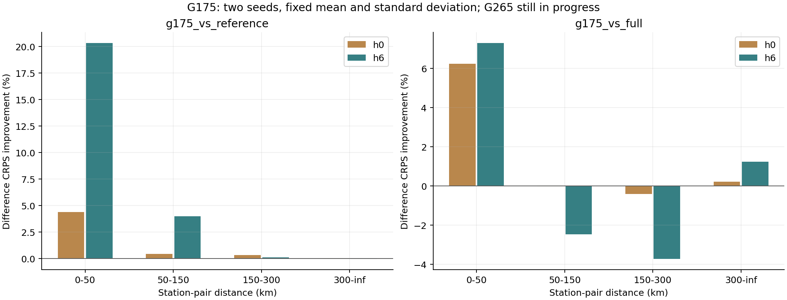

# G175条件相关核：双种子阶段结果

G175各3000连续块已经完成；G265及其预注册Local/Affine连接仍在运行，本报告不替代完整四臂结果。2020每月8–10日×三布局×137查询为已暴露开发。

## 核心结果

逐值核验两个种子的基础场预测、Gaussian解析均值和标准差与各自参考完全相同；解析边际CRPS也完全相同。下表仅反映空间依赖变化。

| 距离/km | 当前差值CRPS改善 | F6差值CRPS改善 | F6差值95%区间/mm |
|---|---:|---:|---|
| 0-50 | 4.39% | 20.29% | [-1.3093893203357994, -0.8302919646578371] |
| 50-150 | 0.43% | 3.99% | [-0.3669784984927955, -0.2595053434811114] |
| 150-300 | 0.32% | 0.13% | [-0.035806674483747566, 0.009739459567714022] |
| 300-inf | 0.06% | -0.02% | [-0.00015528947564062977, 0.006259701961910368] |

seed42/17近邻F6解析差值CRPS分别4.139470/4.115608mm，相对各自参考改善21.13%/19.42%。当前近邻也改善，≥300km基本持平。G175无需改动已验证均值即可学习这项联合收益；它是条件Gaussian核，不是新增扩散收益。

## 相对原Full的同来源比较

| 距离/km | F6改善 | F6差值95%区间/mm |
|---|---:|---|
| 0-50 | 7.29% | [-0.4350562126525558, -0.23493311253621052] |
| 50-150 | -2.47% | [0.13325939879496723, 0.2368539181544989] |
| 150-300 | -3.72% | [0.15971238737382237, 0.538793993022861] |
| 300-inf | 1.24% | [-0.3186216276670885, 0.022324764320792615] |

此项使用Gaussian解析CRPS与Full的K32 IID fair CRPS比较，二者估计同一分布评分，Full含有限成员波动。它比较整套方法，不将所有差异单独归因为一个参数。全场energy来源完整时在JSON列出；尚未完成的项不补造。

完整来源和各lead结果见[g175_checkpoint.json](g175_checkpoint.json)。G175/G265额外日期政策在读新增日期成绩前另行锁定，属于冻结补充开发验证。

G175仍对959维完整时空矩阵分解，本报告不据网络调用次数推断端到端推断更快。固定G265的预注册扩散连接政策保持原样，G175的阶段成绩不回改旧实验锁。
