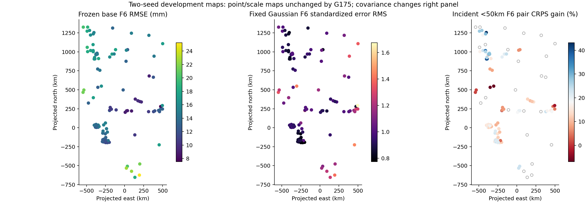

# G175局地概率收益与待改进站点

对冻结主日历进行只读诊断。0–50km的720站对中，<1km为0对，0–5/5–15/15–50km分别35/174/511对；无近邻的站点在地图右图为空心灰点。

| 距离/km | 站对数 | F6 CRPS改善 | F6差值95%区间/mm |
|---|---:|---:|---|
| 0-5 | 35 | 32.55% | [-1.754953198415182, -1.2128399253676656] |
| 5-15 | 174 | 29.06% | [-1.6429355848011415, -1.1040093382672787] |
| 15-50 | 511 | 17.24% | [-1.1697632900837254, -0.7167456140664776] |

左图为基础场F6误差，中图为Gaussian预测均值/标准差下的标准化误差RMS；它们在G175与参考间不变。右图为每站关联<50km站对的fair CRPS改善，表达差值分布的收益，不代表点值RMSE改善。

## 需要优先改进的基础场站点

| 站点 | 当前R/mm | F6/mm | F6有效小时 | 近条件站中位距离/km | 高程/m | 海岸距离/km | F6标准化误差RMS |
|---|---:|---:|---:|---:|---:|---:|---:|
| PLTX | 17.851 | 25.242 | 858 | 98.2 | 271 | 47.8 | 1.401 |
| P475 | 17.351 | 22.686 | 863 | 90.1 | 11 | 0.0 | 1.169 |
| PTEX | 17.077 | 22.517 | 861 | 90.3 | 374 | 38.1 | 1.240 |
| P510 | 10.453 | 21.516 | 861 | 22.5 | 36 | 142.4 | 1.175 |
| P786 | 15.976 | 21.499 | 720 | 142.1 | 111 | 19.4 | 1.235 |
| P316 | 15.437 | 21.412 | 720 | 113.2 | 263 | 1.1 | 1.342 |
| P472 | 14.505 | 20.262 | 864 | 71.0 | 172 | 14.2 | 1.119 |
| PTAL | 12.776 | 19.919 | 864 | 86.8 | 109 | 6.1 | 1.069 |
| P398 | 12.694 | 19.161 | 864 | 123.2 | 46 | 1.0 | 0.926 |
| NANO | 12.030 | 18.945 | 864 | 87.9 | 24 | 3.3 | 0.995 |

137注册查询中，当前/F6实际有标签的站点分别为135/135。缺标签站保留预测、误差记NA；三布局共用的观测小时只计一次。空心灰点也可能表示缺少有效配对标签。

按月份共同重采样、两个种子共享月份，区间未经多重比较校正。逐站地图为探索性定位；全部137站及当前差值结果见[locality.json](locality.json)。
