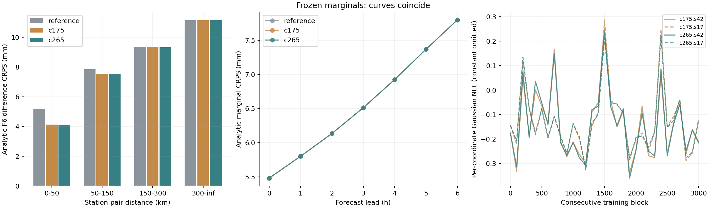

# 天气条件时空Gaussian核：双种子结果

2016–2019各3000连续12h块，仅抽站身份；2020每月8–10日、三布局、137查询，已暴露开发。冻结S175解析均值与边际尺度，单独保留TF3000基础场点预测。G175与G265分别43893/44027参数。

| 模型 | 0–50km F6解析差值CRPS/mm | 内部增量解析CRPS/mm | K32 fair energy/mm |
|---|---:|---:|---:|
| reference | 5.178255 | 3.256206 | 8.545406 |
| c175 | 4.127539 | 3.255249 | 8.539252 |
| c265 | 4.103082 | 3.222468 | 8.539592 |

| 比较 | 距离/km | F6差值CRPS改善 | 差值95%区间/mm |
|---|---|---:|---|
| c175_vs_reference | 0-50 | 20.29% | [-1.3093893203357994, -0.8302919646578371] |
| c175_vs_reference | 50-150 | 3.99% | [-0.3669784984927955, -0.2595053434811114] |
| c175_vs_reference | 150-300 | 0.13% | [-0.035806674483747566, 0.009739459567714022] |
| c175_vs_reference | 300-inf | -0.02% | [-0.00015528947564062977, 0.006259701961910368] |
| c265_vs_reference | 0-50 | 20.76% | [-1.336542712408783, -0.8522215944942628] |
| c265_vs_reference | 50-150 | 4.05% | [-0.3722749098552884, -0.26210157622184643] |
| c265_vs_reference | 150-300 | 0.18% | [-0.03936365973049973, 0.004879120393823864] |
| c265_vs_reference | 300-inf | -0.02% | [-0.0004269609240328265, 0.005834558614748129] |
| c265_vs_c175 | 0-50 | 0.59% | [-0.034239787194740044, -0.013530497325976146] |
| c265_vs_c175 | 50-150 | 0.06% | [-0.007400792095474107, -0.0016746055350033272] |
| c265_vs_c175 | 150-300 | 0.05% | [-0.007930328031007572, -0.0009927946145742886] |
| c265_vs_c175 | 300-inf | 0.00% | [-0.00045130570982974125, -0.00024229495115335459] |

边际均值、标准差、truth与确定性预测逐值相同，解析边际CRPS精确相同；K32边际采样分数的差异来自有限成员。上表站对与增量使用Gaussian解析分布，energy使用32个IID成员。共同月份区间为探索性开发比较。

完整来源、能量评分区间和h0结果见[weather_gp_summary.json](weather_gp_summary.json)。
