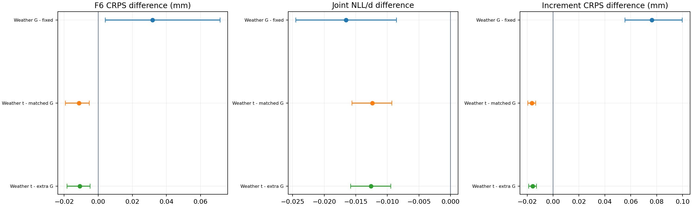

# 最后一轮天气尺度与同协方差Student-t对照

原2016–2019连续3000块，两个固定种子；2020每月8–10日三布局、137查询、K32 IID开发评价。均值全部等于原TF3000；G_weather/T_weather尺度和标准差数组逐值相同，新增MLP均10049参数，额外Gaussian与尾部阶段预算相同。

| 模型 | 当前CRPS/mm | F6 CRPS/mm | 内部增量CRPS/mm | 近邻F6差值CRPS/mm | joint NLL/d | 80%参考F6覆盖率 |
|---|---:|---:|---:|---:|---:|---:|
| fixed | 5.481342 | 7.809858 | 3.144597 | 4.025022 | 3.000885 | 0.784566 |
| constant | 5.467178 | 7.832834 | 3.215656 | 4.112488 | 2.983943 | 0.833270 |
| G_weather | 5.469979 | 7.841648 | 3.220819 | 4.122178 | 2.984347 | 0.833087 |
| G_extra | 5.470004 | 7.841116 | 3.220320 | 4.121921 | 2.984542 | 0.832858 |
| T_constant | 5.466864 | 7.831004 | 3.203809 | 4.101700 | 2.971949 | 0.827305 |
| T_weather | 5.468038 | 7.830358 | 3.204560 | 4.102327 | 2.971953 | 0.827454 |

## 预注册主比较及额外预算控制

- T_weather_vs_G_weather：F6差值-0.011290mm，95%共同月份区间[-0.01920824465900341, -0.005173794489223283]。
- T_weather_vs_G_extra：F6差值-0.010759mm，95%共同月份区间[-0.018297785494043373, -0.004738117884881845]。
- T_weather_vs_T_constant：F6差值-0.000646mm，95%共同月份区间[-0.002033606810180006, 0.0008550032741947478]。

完整事件、覆盖率、源和区间见[summary.json](summary.json)。联合对数评分与单站精度分开解释；strict_oof=false，既有未来可用性选站与历史质控限制保留，确认及原C/D未读。本轮结束后按用户要求停止新增实验。
