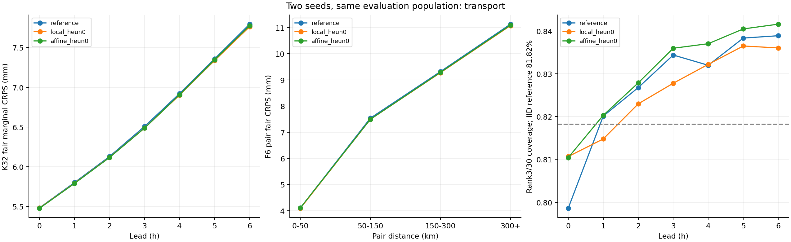

# 天气G265之上的Local与Affine轨迹传输

2016–2019训练；2020抽样日期为开发暴露。双种子、K32 IID成员；不代表全年或严格折外。

| 模型 | 当前CRPS/mm | F6 CRPS/mm | 内部增量CRPS/mm | 0–50km F6差值CRPS/mm | energy/mm |
|---|---:|---:|---:|---:|---:|
| reference | 5.482927 | 7.793582 | 3.222781 | 4.102779 | 8.539592 |
| local_heun0 | 5.479581 | 7.760754 | 3.146364 | 4.088399 | 8.518440 |
| affine_heun0 | 5.476663 | 7.773600 | 3.133925 | 4.107038 | 8.519865 |
| local_ddim | 5.479829 | 7.752711 | 3.134659 | NA | NA |
| affine_ddim | 5.477368 | 7.763700 | 3.124313 | NA | NA |

| 比较 | 指标 | 改善 | 差值95%区间 |
|---|---|---:|---|
| local_heun0_vs_reference | crps_h0 | 0.061% | [-0.008033956556407802, 0.0009419938059518595] |
| local_heun0_vs_reference | crps_h6 | 0.421% | [-0.04963459646325798, -0.019409355339713046] |
| local_heun0_vs_reference | increment | 2.371% | [-0.09161674595889033, -0.06343612032873293] |
| local_heun0_vs_reference | pair_0-50_h6 | 0.350% | [-0.023245767668565582, -0.007031374010986676] |
| local_heun0_vs_reference | energy | 0.248% | [-0.03292531232692988, -0.010972616347029434] |
| affine_heun0_vs_reference | crps_h0 | 0.114% | [-0.013912199518745927, 0.0003902762530966552] |
| affine_heun0_vs_reference | crps_h6 | 0.256% | [-0.033648376484289096, -0.007476213569813074] |
| affine_heun0_vs_reference | increment | 2.757% | [-0.10582715501273386, -0.07455456815572845] |
| affine_heun0_vs_reference | pair_0-50_h6 | -0.104% | [-0.002247908367974038, 0.011408355629082653] |
| affine_heun0_vs_reference | energy | 0.231% | [-0.03378831591471572, -0.006795240060304262] |
| local_ddim_vs_reference | crps_h0 | 0.057% | [-0.00782021274479655, 0.001896955384007285] |
| local_ddim_vs_reference | crps_h6 | 0.524% | [-0.06295906864548564, -0.02363803732251238] |
| local_ddim_vs_reference | increment | 2.734% | [-0.10576364361664868, -0.07246506740751829] |
| affine_ddim_vs_reference | crps_h0 | 0.101% | [-0.014043964663826014, 0.002728965590123302] |
| affine_ddim_vs_reference | crps_h6 | 0.383% | [-0.04657464149967313, -0.015182440030687852] |
| affine_ddim_vs_reference | increment | 3.055% | [-0.11798467549513708, -0.08164508378238018] |
| local_heun0_vs_affine_heun0 | crps_h0 | -0.053% | [-0.002170350507067159, 0.008388844394371014] |
| local_heun0_vs_affine_heun0 | crps_h6 | 0.165% | [-0.023508658703636484, -0.0029740920695376307] |
| local_heun0_vs_affine_heun0 | increment | -0.397% | [0.008610873680662046, 0.015990609082964395] |
| local_heun0_vs_affine_heun0 | pair_0-50_h6 | 0.454% | [-0.027565138590875993, -0.011114818900321996] |
| local_heun0_vs_affine_heun0 | energy | 0.017% | [-0.007397574787538123, 0.003349459183960692] |
| local_ddim_vs_affine_ddim | crps_h0 | -0.045% | [-0.003303420786675307, 0.008710337959589075] |
| local_ddim_vs_affine_ddim | crps_h6 | 0.142% | [-0.021398931220327662, -0.0014377412234000653] |
| local_ddim_vs_affine_ddim | increment | -0.331% | [0.006901673143570648, 0.013762424233938768] |

## 均值与作用范围

概率分数表使用同一总体上的K32 fair估计；Gaussian解析分数及四距离档、覆盖、逐月和来源另列JSON。DDIM为边际及增量采样器复核，未另做全场joint评分，表中NA表示未评估。
均值诊断以(barY-y)^2-s²/K估计条件均值MSE；与确定性基础场相减，单位mm²。它可逐点为负，不等于生成样本自身RMSE，也不宜开方后声称精确RMSE。

| 模型 | 当前均值MSE相对基础场/mm² | 95%区间 | F6差值/mm² | 95%区间 |
|---|---:|---|---:|---|
| reference | 0.528157 | [0.060473381779748724, 1.199100346867704] | -1.613104 | [-4.582854284505293, 1.0989890877121316] |
| local_heun0 | 0.509148 | [0.023811160501503503, 1.1632653851482933] | -3.558513 | [-7.534740007236326, -0.39428110441647907] |
| affine_heun0 | 0.509331 | [0.10543087342195168, 1.074471130049098] | -2.926764 | [-7.074933301628014, 0.4057786969928191] |
| local_ddim | 0.508493 | [0.027582517969370494, 1.161058815153491] | -3.567825 | [-7.547415254140331, -0.43040778011309927] |
| affine_ddim | 0.506582 | [0.10624504036659152, 1.0647952962781275] | -2.926041 | [-7.085619573548683, 0.4064988689069028] |

## 六小时快速变化事件

沿用先前冻结的10/20/30mm阈值，主阈值20mm；将相同定义应用于本轮新模型，属开发探索。增湿与减湿均在全部有效起点上评分。所有阈值与事件计数见JSON。

| 比较 | 方向 | 指标 | 改善 | 差值95%区间 |
|---|---|---|---:|---|
| local_heun0_vs_reference | increase | brier | 0.631% | [-0.0006555747306590214, -0.000235828188586907] |
| local_heun0_vs_reference | increase | tail | 0.661% | [-0.006872194470535211, -0.002510086303549085] |
| local_heun0_vs_reference | decrease | brier | 0.964% | [-0.000837030868928592, -0.0003062929909619472] |
| local_heun0_vs_reference | decrease | tail | 0.748% | [-0.00906268404282252, -0.0015883871626588186] |
| affine_heun0_vs_reference | increase | brier | 0.625% | [-0.0007036914506585478, -0.00017523925023200964] |
| affine_heun0_vs_reference | increase | tail | 0.685% | [-0.0075379127535888215, -0.0018423371503154162] |
| affine_heun0_vs_reference | decrease | brier | 1.111% | [-0.0009316998627659089, -0.0003843129552765059] |
| affine_heun0_vs_reference | decrease | tail | 0.677% | [-0.008713368236873782, -0.000806182827903095] |
| local_heun0_vs_affine_heun0 | increase | brier | 0.006% | [-0.0003026903459409311, 0.0003281722336966171] |
| local_heun0_vs_affine_heun0 | increase | tail | -0.024% | [-0.0028777975351457186, 0.003375815462078852] |
| local_heun0_vs_affine_heun0 | decrease | brier | -0.149% | [-0.0002477463133796482, 0.000362329288464205] |
| local_heun0_vs_affine_heun0 | decrease | tail | 0.071% | [-0.003978188577709214, 0.0025761608076526783] |

reference为冻结G265及S175解析中心/尺度，非严格TF3000中心。Local/Affine共享天气条件和GP初值；训练为逐查询7h边际score，未声称学习完整真实空间联合score。Heun0主评价39NFE，DDIM复核40NFE。

月份共同重采样2000次，两个种子共享月份，区间未经多重比较校正。确认及原C/D标签未读取。

完整记录见[summary.json](summary.json)。
