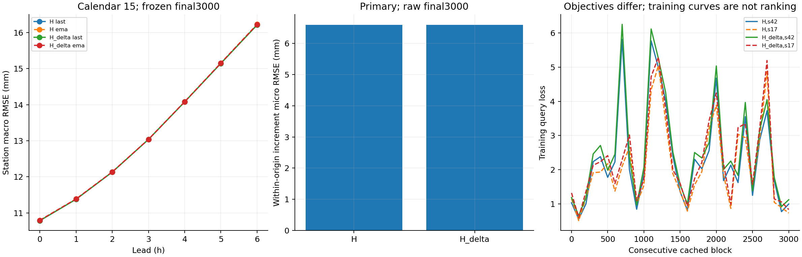

# 固定H架构：内部增量监督的真实训练结果

2016–2019原连续缓存，同源TF3000各新增3000，种子42/17；2020每月15日起72h三布局，已暴露开发。raw final3000为主，EMA并列。H_delta唯一训练变化是原query目标加0.5×同起点内部lead差分损失；原跨起点h0差分保留。

| 模型 | 权重 | 当前站宏RMSE/mm | 六小时站宏RMSE/mm | 跨起点当前增量站宏RMSE/mm | 同起点内部增量microRMSE/mm |
|---|---|---:|---:|---:|---:|
| H | last | 10.786360 | 16.211124 | 6.318779 | 6.598862 |
| H | ema | 10.796526 | 16.225837 | 6.324534 | 6.602249 |
| H_delta | last | 10.786318 | 16.207798 | 6.317700 | 6.597349 |
| H_delta | ema | 10.796624 | 16.220839 | 6.323938 | 6.600848 |

## 配对比较

- last：内部增量micro RMSE差值-0.001513mm，95%共同月份区间[-0.00203891218647565, -0.0010994111069872138]；当前/六小时站宏RMSE区间[[-0.0005624251614251286, 0.00046571315916308357], [-0.00783764646956473, 0.00170848737254765]]；跨起点当前增量区间[-0.0012708098716324168, -0.000905639779707812]。
- ema：内部增量micro RMSE差值-0.001401mm，95%共同月份区间[-0.0018339373366103695, -0.0010416063948563428]；当前/六小时站宏RMSE区间[[-0.00024648984326507416, 0.0004738930462011568], [-0.008802096949052495, -0.0010300156323199694]]；跨起点当前增量区间[-0.0007225037853270999, -0.0004728471785476085]。

差值为H_delta−H，负值表示误差减少。主要估计量先在每种子内合并有效样本计算micro RMSE，再平均两种子；月份重采样对两模型及两种子共享。分层记录为MSE，不与站宏RMSE混排；稀疏季节分层若空重采样，区间记NA。
final3000 raw/EMA逐tensor、同一源权重/缓存、truth/reference逐值、导出数组、几何/条件距离及lineage哈希均核验。strict_oof=false，未来可用性选站等旧数据限制保留；确认及原C/D标签未读，区间条件于两个固定种子且未经多重比较校正。

完整来源、分层与配对结果见[summary.json](summary.json)。
