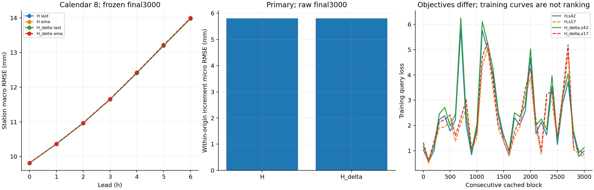

# 固定H架构：内部增量监督的真实训练结果

2016–2019原连续缓存，同源TF3000各新增3000，种子42/17；2020每月8日起72h三布局，已暴露开发。raw final3000为主，EMA并列。H_delta唯一训练变化是原query目标加0.5×同起点内部lead差分损失；原跨起点h0差分保留。

| 模型 | 权重 | 当前站宏RMSE/mm | 六小时站宏RMSE/mm | 跨起点当前增量站宏RMSE/mm | 同起点内部增量microRMSE/mm |
|---|---|---:|---:|---:|---:|
| H | last | 9.811031 | 13.977705 | 5.545044 | 5.803134 |
| H | ema | 9.817113 | 13.994826 | 5.550050 | 5.805539 |
| H_delta | last | 9.811195 | 13.973126 | 5.544171 | 5.801856 |
| H_delta | ema | 9.817214 | 13.990427 | 5.549516 | 5.804415 |

## 配对比较

- last：内部增量micro RMSE差值-0.001279mm，95%共同月份区间[-0.001680583611562214, -0.0008919877181565617]；当前/六小时站宏RMSE区间[[-0.0006463091677108235, 0.0009017063076966368], [-0.008074030739634442, -0.0005747889793155103]]；跨起点当前增量区间[-0.001122164093998701, -0.0006703848157763482]。
- ema：内部增量micro RMSE差值-0.001124mm，95%共同月份区间[-0.0014887773314334108, -0.0007995449529499932]；当前/六小时站宏RMSE区间[[-0.0005143754841828496, 0.0006476770138776455], [-0.0071957244572422585, -0.001474406682241325]]；跨起点当前增量区间[-0.0006907830949805626, -0.0003871247569138482]。

差值为H_delta−H，负值表示误差减少。主要估计量先在每种子内合并有效样本计算micro RMSE，再平均两种子；月份重采样对两模型及两种子共享。分层记录为MSE，不与站宏RMSE混排；稀疏季节分层若空重采样，区间记NA。
final3000 raw/EMA逐tensor、同一源权重/缓存、truth/reference逐值、导出数组、几何/条件距离及lineage哈希均核验。strict_oof=false，未来可用性选站等旧数据限制保留；确认及原C/D标签未读，区间条件于两个固定种子且未经多重比较校正。

完整来源、分层与配对结果见[summary.json](summary.json)。
