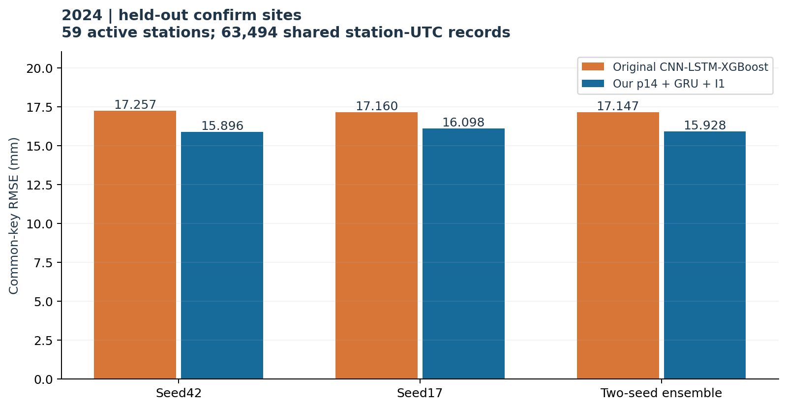
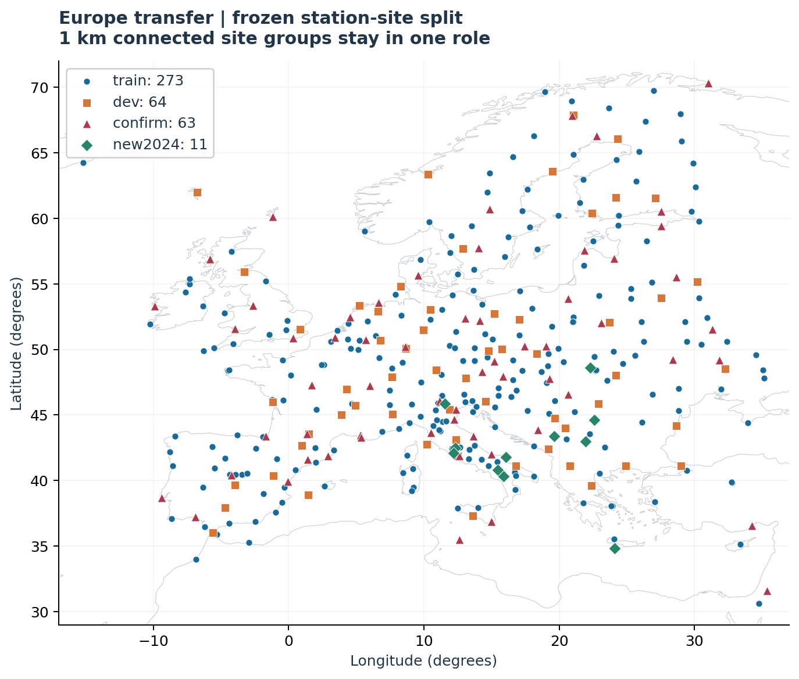
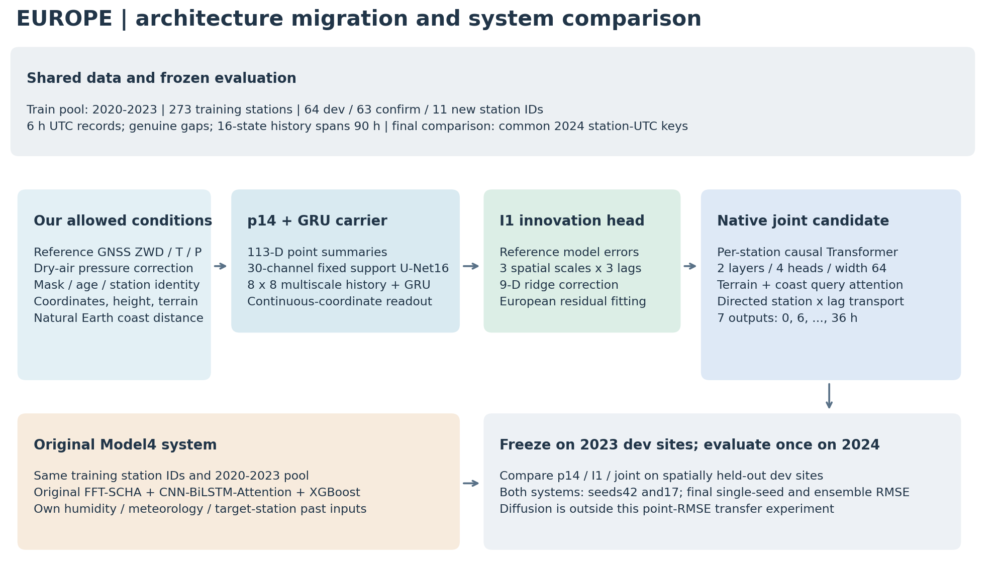
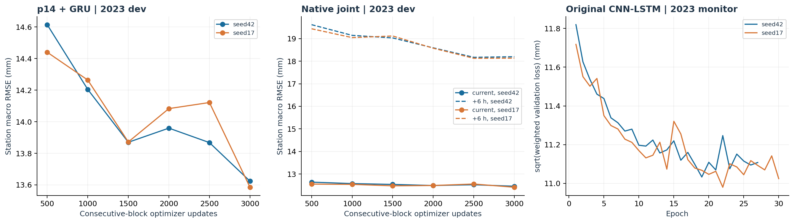
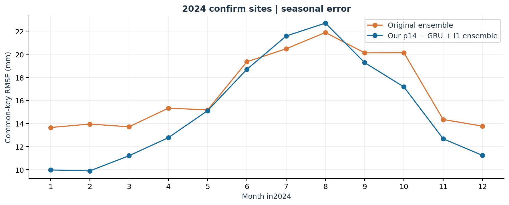
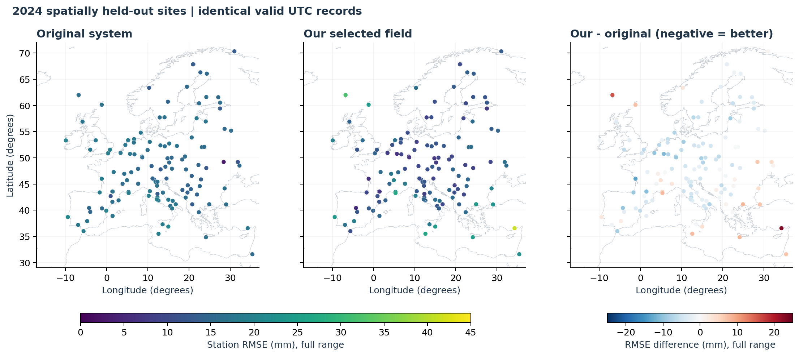
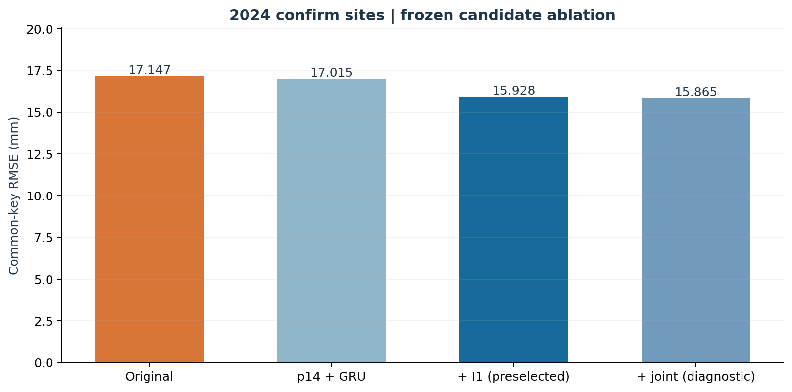

# 欧洲数据上的架构迁移与最终RMSE

正式v2在Model4欧洲数据上完成2020–2023训练池迁移，并在2024完整年度的共同有效站–UTC记录上比较原CNN-LSTM-XGBoost。2023开发站选择的点输出架构为 **p14＋GRU＋I1**；两系统均报告seed42、seed17及双种子集成（先对预测等权平均，再计算RMSE）。最终留站集成RMSE由17.1472降至15.9279mm，降低7.11%。两个种子均改善。



## 数据与站点划分

400个训练期站和385个2024站合并为411站，374站跨年共享。按1km连通物理站址分组，再按坐标空间分层划分273训练、64开发、63最终留出站；另有11个2024新站。训练、开发和最终留站之间没有1km物理组交叉；新站如果与训练站同址，从“新站未见站址”指标中剔除。确认站BISK、CNIV、SMI2、SMID在2024源包无标签，故63注册站中59站进入实际评价。完整站点清单见[stations.csv](stations.csv)，逐站覆盖数见[heldout_coverage.csv](heldout_coverage.csv)，源文件SHA和单位审计见[data_audit.json](data_audit.json)。



输入是实际6h UTC记录，保留缺测，不造小时值。16记录历史跨度90h，7个输出对应0/6/12/18/24/30/36h。本报告主指标为当前ZWD的RMSE，单位mm。2024已在历史研究中暴露，本轮属于年度回看。共同键规则同时要求两系统、两个种子和标签有效；每站断测引起的旧模型连续序列缺失在共同覆盖率中如实体现。

## 网络和特征

本模型复用实际p14固定载体U-Net16、113维多尺度点读出、原8×8 GRU历史分支及海岸/地形边分支；随后拟合9维I1历史创新岭头，并训练实际NativeDirectedLagV2因果Transformer候选。逐站15维状态包含GNSS/T/P、mask、age、模型误差和时钟，身份嵌入独立保留，查询注意力用方向、高差、地形和海岸关系传递信息；新增校正头零初始化。



新模型只使用参考站GNSS ZWD、T、P及静态几何/地形/海岸和时间条件。P由ERA5原始气压、T、高差进行干空气高程修正；不读原流程WVP、TCWV、FFT-SH及VMF3特征。欧洲地形采用站点ERA5静态地形的32×32粗载体插值，梯度和粗糙度从该粗场计算；不是美国SRTM地形的直接复制。海岸距离来自Natural Earth1:5000万海岸线的EPSG3035投影线段距离；源文件名50m中的m表示million，并非50米。

原模型按相同273训练站重新拟合原FFT-SCHA、CNN-BiLSTM-Attention和XGBoost，保留其原始湿度、气象和目标站历史特征。FFT-SCHA使用2020–2023；CNN-LSTM按原流程2020–2022拟合、2023早停；XGBoost在2023年前9个月拟合/Q4早停后按全年重拟合。本模型正式v2基础场、I1和joint使用2020–2023训练站池，2023监控是独立站址开发监控。两者训练站和总体年份一致，各自特征及训练阶段不同，因此结果是系统效果比较。

空间场在留出目标的整个站址历史上均不读GNSS；原模型允许读该目标站严格早于当前的历史及其气象湿度。两者最终预测的是同一份Model4 ZWD标签，标签和行筛选继承原制包谱系。以上信息条件应与RMSE同时解释。

## 训练与冻结选择

正式v2 p14+GRU、joint各两个种子、每种子3000连续四记录块，时间按顺序遍历，仅条件站动态轮换。训练标签来自训练站，开发/确认站标签不用于梯度和I1拟合。2023固定24个四记录开发块的两种子平均站宏RMSE：p14_gru=13.6043mm、i1=12.4249mm、joint=12.4375mm。根据此结果在读取2024评价指标前冻结i1，见[selection_2023_v2.json](selection_2023_v2.json)。三年神经阶段v1保留为先行诊断，不与正式四年版混排。



原CNN-LSTM保留50epoch上限、8epoch早停，XGBoost保留3000树上限和原默认参数；本模型使用固定3000块研究预算。计算预算不是相同更新数或相同样本数。曲线中的原模型损失为sigma加权损失，其平方根与最终无权RMSE分别标注。

## 最终RMSE

主表采用双种子预测集成，micro RMSE为所有共同有效记录的误差平方平均后开方；站宏RMSE及所有中间模型数值另见[comparison.json](comparison.json)。

| 评价人口 | 有效站 | 共同记录 | 原模型RMSE/mm | 本模型RMSE/mm | 本模型−原模型/mm |
|---|---:|---:|---:|---:|---:|
| 最终留站 | 59 | 63,494 | 17.1472 | 15.9279 | -1.2193 |
| 开发站年度回看 | 61 | 67,574 | 16.0463 | 13.9843 | -2.0620 |
| 新站且站址未见 | 11 | 5,390 | 15.9564 | 13.7955 | -2.1609 |
| 全部空间留出 | 131 | 136,458 | 16.5642 | 14.9132 | -1.6510 |

最终留站单种子结果：

| 种子 | 原模型RMSE/mm | 本模型RMSE/mm |
|---|---:|---:|
| 42 | 17.2569 | 15.8958 |
| 17 | 17.1604 | 16.0985 |





## 增益来源与重点误差

I1是本轮主要增益来源。它在相同欧洲基础场上利用条件站可观测模型误差构造历史创新校正；本轮同条件候选的确认站RMSE如下。joint在2024有小幅额外点值收益，主模型仍按预先冻结的2023开发选择报告。

| 本模型候选 | seed42 RMSE/mm | seed17 RMSE/mm | 双种子集成RMSE/mm |
|---|---:|---:|---:|
| p14_gru | 17.1012 | 17.1105 | 17.0149 |
| i1 | 15.8958 | 16.0985 | 15.9279 |
| joint | 15.8737 | 16.0185 | 15.8655 |



59个有效确认站中，47个站的本模型RMSE低于原模型。冬季1–2月分别为9.98/9.89mm；夏季7–8月为21.58/22.71mm，同期原模型为20.48/21.89mm。年度改善主要出现在冬春及秋冬，7–8月和部分沿海/岛站是下一步的重点。

| 重点站 | 原模型/mm | 本模型/mm | 当前有效参考站最近距离中位数/km |
|---|---:|---:|---:|
| MERS | 18.429 | 41.471 | 178.6 |
| MARS | 19.025 | 27.002 | 137.4 |
| LAMP | 19.170 | 26.911 | 264.9 |
| NOT1 | 21.026 | 25.012 | 145.2 |
| LERI | 17.173 | 24.435 | 344.8 |
| CASC | 21.564 | 24.388 | 190.1 |

MERS的本模型误差最高，应优先检查周边参考站代表性及局地湿度变化；该归因需后续控制实验验证。LAMP在当前1:5000万海岸图层上的距离代理为139.4km，下一版应单独核查小岛海岸覆盖；正式结果仍保留本次冻结特征。海岸距离的制图概括尺度、ERA5粗地形和稀疏观测共同构成后续数据审查重点，当前表格不将单一因素当作已证实原因。

逐站及月份原始指标分别见[station_rmse.csv](station_rmse.csv)、[monthly_rmse.csv](monthly_rmse.csv)。当前评价输出为确定性点场；美国概率扩散分支的权重未混入欧洲模型。本轮按用户指定的最终RMSE对比完成，概率分支可在欧洲新残差上独立拟合与评价。

## 复现和产物

Anaconda环境：`D:/anaconda3-2025.12-2/envs/pytorch/python.exe`。实际命令：

```powershell
python -m maintenance.europe_transfer_20261126.data
python -m maintenance.europe_transfer_20261126.train_base --seed 42 --steps 3000 --version 2
python -m maintenance.europe_transfer_20261126.train_base --seed 17 --steps 3000 --version 2
python -m maintenance.europe_transfer_20261126.native --seed 42 --prepare --version 2
python -m maintenance.europe_transfer_20261126.native --seed 17 --prepare --version 2
python -m maintenance.europe_transfer_20261126.native --seed 42 --steps 3000 --version 2
python -m maintenance.europe_transfer_20261126.native --seed 17 --steps 3000 --version 2
python -m maintenance.europe_transfer_20261126.legacy --prepare-only
python -m maintenance.europe_transfer_20261126.legacy --seed 42
python -m maintenance.europe_transfer_20261126.legacy --seed 17
python -m maintenance.europe_transfer_20261126.evaluate select
python -m maintenance.europe_transfer_20261126.evaluate predict --seed 42
python -m maintenance.europe_transfer_20261126.evaluate predict --seed 17
python -m maintenance.europe_transfer_20261126.evaluate compare
python -m maintenance.europe_transfer_20261126.figures_report
```

首次制包已有同址修正提案历史，当前data.npz不可原地覆盖；重新执行请使用新的版本目录。数据、权重和预测数组位于本机`cache/`与`runs/*/*.pt`，代码、轻量指标、源哈希和图件同步GitHub，原Model4文件保留。
