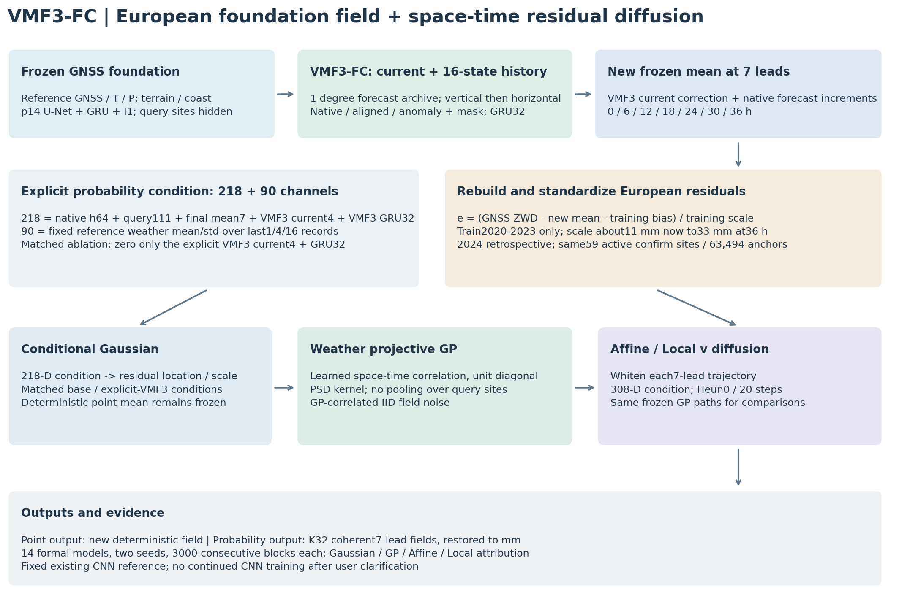
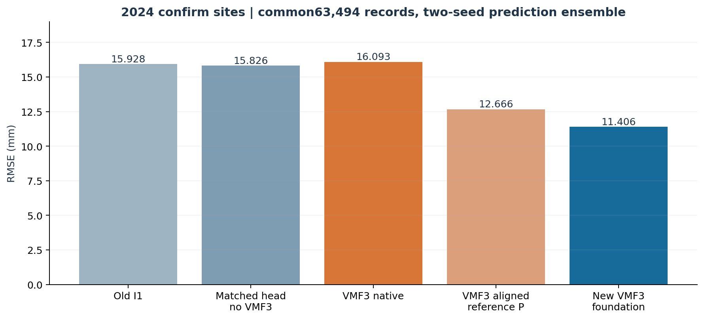
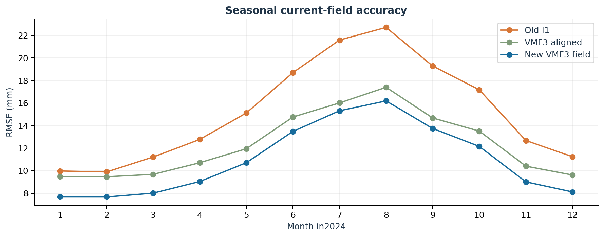
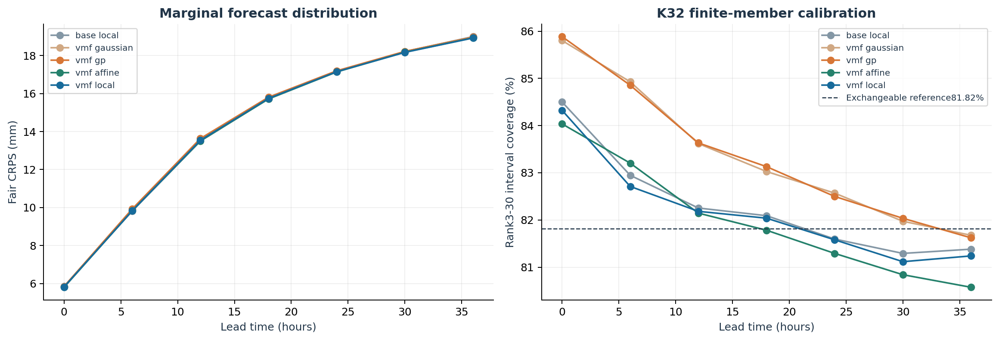
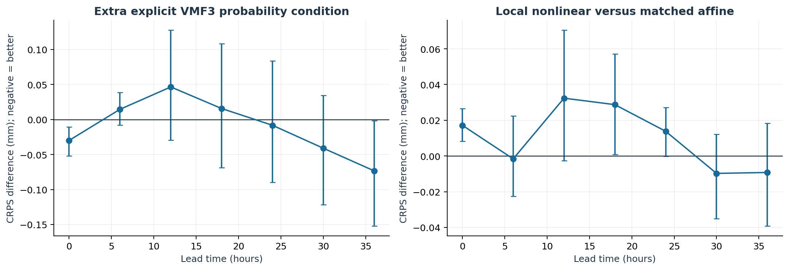
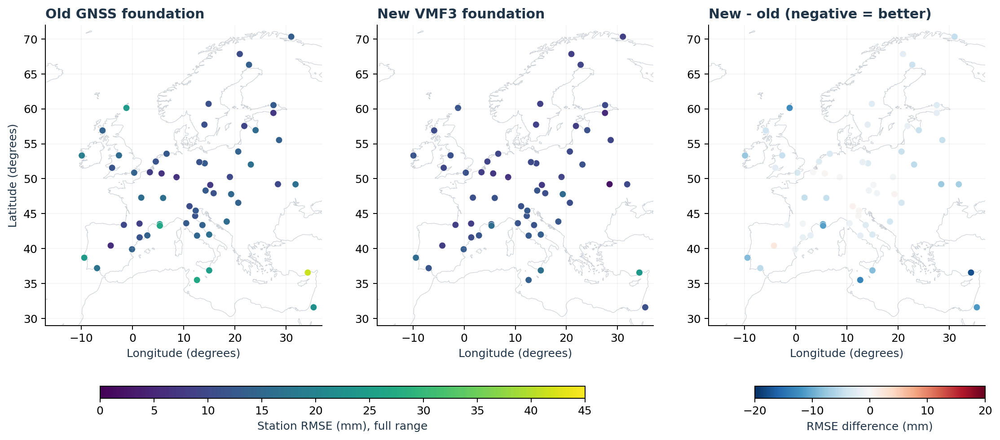
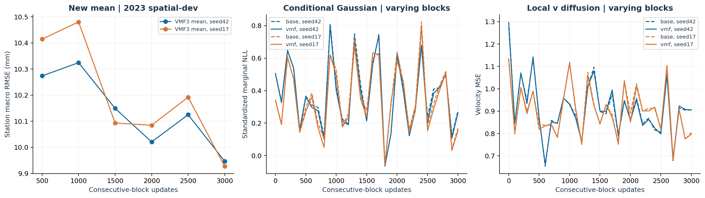

# VMF3-FC条件的欧洲基础场＋时空扩散：完整结果

VMF3-FC已同时进入新基础场和残差扩散条件。2024完整年度回看、相同59有效确认站/63494共同起点上，双种子预测集成的当前场RMSE由15.9279降至11.4064mm，降低28.39%；相对VMF3 aligned直接背景的12.6661mm降低9.95%。固定基础场上，Local相对同条件天气GP的+6h CRPS改善0.96%。非Gaussian相对Affine的额外收益按下方区间单独解释。

按用户修订，已有CNN保留为固定参考，后续研究只训练新融合模型；澄清前已完成的CNN seed42尝试归档，seed17已停止，均不进入本轮主比较。

## VMF3怎样进入模型

VMF3-FC1°预报归档按原CNN的算法处理：四格点分别进行Kouba高程修正，再双线性到查询点。三个背景特征是native ZWD、与本模型干湿口径对齐的aligned ZWD、aligned减原I1场的异常。aligned中的P由原有参考站T/P按干空气高程传递和空间加权得到；目标站GNSS/T/P、WVP、TCWV和原FFT-SCHA均不作为新条件。缺2023-12-18 00UTC的原始背景用mask保留，不从未来有效时刻填充。

当前均值采用冻结p14＋GRU＋I1、111维查询条件与16步VMF3三特征/mask的GRU32校正。该分支两个种子各3000连续四记录块，2023留站监控选择；另外完成同结构、VMF3输入置零的control。未来7时效保留原欧洲因果Transformer的预测增量，以新当前均值作公共偏移，公式为μnew(t,h)=μjoint(t,h)−μjoint(t,0)+μVMF(t,0)。本轮未来部分是这个明确的锚定规则，尚未使用未来VMF3有效时刻作为输入。

概率查询条件为218维：原查询状态64＋原条件111＋最终均值7＋VMF3当前三特征/mask4＋VMF3 GRU状态32。另有固定参考站15维状态在1/4/16记录上的均值/标准差90维，全局天气摘要不依赖查询集合。16状态跨度90h；7输出是0/6/12/18/24/30/36h。

训练残差按e=(y−μnew−b)/s标准化。b、s由2020–2023训练站重新拟合，s约11mm（当前）至33mm（36h）。条件Gaussian学习残差位置/尺度，WeatherProjectiveGP学习PSD、单位对角的空间—时间相关；Local/Affine将每查询7时效轨迹白化，进行v速度传输，再着色并恢复mm。实际复用原NativeGaussian、WeatherProjectiveGP核、LocalTrajectoryVelocity、AffineTrajectoryVelocity与Heun0；欧洲GP适配218＋90条件，不伪造72小时状态。

物理输出为Z=μnew+b+s[mG+σG·T(η)]，η来自耦合GP场。确定性点输出始终为冻结μnew，随机成员均值与概率中心另作诊断；其采样方差不计为基础场精度。

## 确定性场的收益

表格均为两个训练种子的预测先等权平均，再计算共同键RMSE。native/aligned是直接背景，不含新神经训练；control是相同新校正器、无VMF3输入。CNN来自上轮固定273站模型，使用其原气象湿度和同站历史特征，未启用VMF3，仅保留为固定系统参考。主要归因比较原I1/control与直接VMF3背景。

| 点模型 | micro RMSE/mm | 站宏RMSE/mm |
|---|---:|---:|
| 既有CNN固定参考 | 17.1472 | 16.6565 |
| 原p14＋GRU＋I1 | 15.9279 | 14.3791 |
| 新增校正器，无VMF3输入 | 15.8258 | 14.2865 |
| 新VMF3基础场 | 11.4064 | 10.7419 |
| VMF3 native直接背景 | 16.0932 | 15.2627 |
| VMF3 aligned直接背景（参考站P） | 12.6661 | 12.2903 |

VMF3背景加入了新的外部物理信息，收益包含条件信息扩充；control显示新增校正器本身的变化较小。native与aligned的差异也说明干湿分离口径对齐的重要性，融合场在对齐背景之上继续改善。

## 扩散条件的对照与概率结果

base与vmf两臂共享同一个新VMF3基础场及最终7时效均值。base仅把额外显式VMF3当前4维和GRU32维置零，所以它表示“无额外显式VMF3概率条件”，并非整个系统无VMF3。两臂各训练Gaussian、GP、Local；vmf另有同预算Affine。共14模型，每个3000连续块；全部Adam/scheduler真实监督时钟3000。

下面分数为两个固定训练种子的平均，未拼接为64成员分布。每模型K32独立成员；Local/Affine采用Heun0 20步，Gaussian/GP直接采样。GP/Local/Affine共享同源GP噪声路径以作配对比较。当前/未来共用上轮固定起点，未来mask仅用于监督和评分。Gaussian与GP具有相同解析边际，其采样CRPS微差来自有限成员；GP主要检验联合相关结构。

| 概率模型 | 当前CRPS/mm | +6h CRPS/mm | +36h CRPS/mm | 内部6h增量CRPS/mm | 配对场能量/mm |
|---|---:|---:|---:|---:|---:|
| base_gaussian | 5.86412 | 9.93122 | 19.21108 | 11.03121 | 19.09055 |
| base_gp | 5.86546 | 9.93731 | 19.19786 | 10.98786 | 19.09724 |
| base_local | 5.84873 | 9.81332 | 18.99680 | 10.91948 | 18.87067 |
| vmf_gaussian | 5.84057 | 9.91567 | 18.97908 | 11.01124 | 18.90473 |
| vmf_gp | 5.84171 | 9.92266 | 18.96775 | 10.97412 | 18.91017 |
| vmf_affine | 5.80166 | 9.82947 | 18.93264 | 10.91588 | 18.83369 |
| vmf_local | 5.81885 | 9.82785 | 18.92340 | 10.91629 | 18.84804 |

Local相对同VMF条件天气GP的+6h CRPS降低0.09481mm。Local相对Affine的+6h差值为-0.00162mm，95%共同月份重采样区间[-0.02264,+0.02238]，区间跨零；当前Local比Affine高0.01719mm。当前证据支持强Gaussian基础上的传输收益，未建立非Gaussian模块的独立优势。

显式VMF条件对Local的额外当前CRPS差值为-0.02989mm、36h为-0.07340mm；+6h为+0.01453mm，区间[-0.00800,+0.03866]。各时效分别判断，不能概括为全时效统一改善。

K32的第3/30秩区间在交换性条件下参考覆盖率为27/33=81.82%，不是精确80%。Local VMF的当前/+6h秩覆盖为84.32%/82.71%；解析Gaussian80%覆盖另存JSON。月份区间固定本次两个训练种子和采样流，表示该回看年份内的过程变化。场能量采用独立配对估计并除以观测维数平方根；各模型使用相同观测维度。近邻站对的几何选择、数量和分数见[spatial_contrasts.json](spatial_contrasts.json)。

## 区域与下一步

| 上轮重点站 | 原I1/mm | 新VMF场/mm | aligned背景/mm |
|---|---:|---:|---:|
| CASC | 24.388 | 15.759 | 16.259 |
| LAMP | 26.911 | 13.698 | 12.824 |
| LERI | 24.435 | 11.760 | 12.986 |
| MARS | 27.002 | 15.940 | 14.757 |
| MERS | 41.471 | 23.910 | 20.889 |
| NOT1 | 25.012 | 16.443 | 15.557 |

VMF3明显改善了上轮较难的沿海/岛站；MERS仍有较高误差，部分站的直接aligned背景优于融合场。下一步优先检验按参考站距离/覆盖/地形调节的背景融合权重，并核实预报发布时间后再接入可在起点获取的多时效VMF3预报。概率侧先解释Gaussian/Affine已获得的校准收益，再针对有证据的非Gaussian残差设计扩散改进。

## 数据范围与核验

继承273训练/64开发/63注册确认/11新站的1km物理组隔离；2020–2023拟合、2023开发为留站监控，2024为历史已暴露年度回看。确认63站中59有本轮共同有效记录。原Model4标签和湿度参与制包筛选的谱系保留；strict_oof=false。原始NWP归档仅验证有效时刻映射，未逐文件追溯发布时间，不将本轮称为业务实时预报验证。滚动起点间独立采样，每起点内生成相关7时效场。

[点值完整指标](point_results.json) · [概率完整指标和区间](probability_results.json) · [训练时钟核验](training_verification.json) · [导出来源seed42](diffusion_source_s42.json) · [seed17](diffusion_source_s17.json) · [标准化统计seed42](residual_statistics_s42.json) · [seed17](residual_statistics_s17.json) · [固定采样协议](probability_lock.json) · [原欧洲架构与站址划分](../europe_transfer_20261126/REPORT.md) · [计划](../../docs/superpowers/plans/2026-11-26-europe-vmf3-diffusion.md)

原始网格、缓存、权重和大样本数组留本地；代码、轻量协议、指标、图件和来源哈希同步GitHub。
