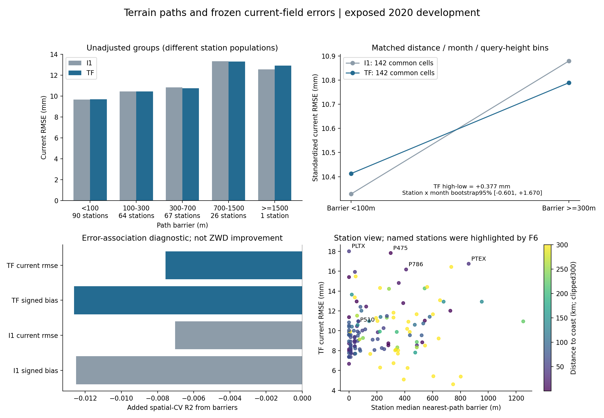

# Query–条件站路径地形屏障审计

seed42，2020每月8–10日已暴露开发日历，137开发站、3布局。I1与冻结Transformer physics_aux均使用既有预测；本报告解释当前重建误差的空间关联，不新增ZWD精度或因果结论。

## 单位、来源与可见性

使用144×96、25km中心格网DEM，覆盖567条实际最近站路径；origin以米表示，站xy以km表示，static[:,:2]×1000恢复km。网格中心与Lambert投影数值核验通过，投影误差4.95e-09m；注册高程基准为EGM96。
从history最后12帧逐origin的GNSS mask和context_ids重建可见站。cached nearest最大复算差0.0000141km；忽略缺测会改变最近站的query-origin数为13680。
有效当前标签且路径未截边：327,330条；截边0条（主分析排除），0个站对。路径31点双线性插值；25km DEM衡量区域地形，不解析细窄山脊。

每条记录为布局×起点×查询站，3布局复用观测，不是独立小时。注册137开发站中，135站有当前有效标签；无当前标签站为P691, P695，缺测标签记录共27,774条。

主proxy=max(DEM路径高程−GNSS两端站高线性连线,0)。同时记录maxDEM−max(两端站高)，并用DEM端点连线作敏感性核查，以区分路径起伏与DEM/站点高程支持差。

## 分层结果

| 屏障/m | 有效小时 | 站数 | I1 bias/mm | I1 RMSE/mm | TF bias/mm | TF RMSE/mm |
|---|---:|---:|---:|---:|---:|---:|
| <100 | 159654 | 90 | 0.636 | 9.676 | 0.296 | 9.705 |
| 100-300 | 61905 | 64 | -0.222 | 10.440 | -0.649 | 10.454 |
| 300-700 | 83911 | 67 | 0.449 | 10.830 | 0.252 | 10.741 |
| 700-1500 | 21277 | 26 | -1.759 | 13.335 | -1.938 | 13.297 |
| >=1500 | 583 | 1 | -6.128 | 12.551 | -6.646 | 12.917 |

表内小时数指含3布局的站时记录。指标为记录微RMSE；JSON另给子集站均RMSE，不能与原主日历站宏RMSE混排。

## 相同距离、月份与query高程范围

距离[0,50,100,150,200,300,+∞)km，高程[-∞,250,750,1500,2500,+∞)m，月份固定。低屏障<100m、高屏障≥300m；每格每组≥2站且≥48小时。按两组较小样本量加权，保留共同支撑。区间按站和月份交叉重采样，仅作探索。

- I1：142个共同格；低/高组85/69站、125679/88146小时。高−低bias=-0.716mm，95%区间[-2.323, 1.088]；RMSE差=0.552mm，区间[-0.382, 1.874]。
- TF：142个共同格；低/高组85/69站、125679/88146小时。高−低bias=-0.725mm，95%区间[-2.301, 1.036]；RMSE差=0.377mm，区间[-0.601, 1.67]。
- 再固定布局的TF敏感性：233个共同格，RMSE高−低差0.614mm，区间[-0.769, 2.359]。

## 与现有局地地形信息比较

固定5折100km空间块分组的诊断回归，以站×布局×月份的当前bias或RMSE为解释对象。基准包含距离、高程/高差、两端roughness/坡度/站高−局地DEM、海岸距离、月和布局；新增两个屏障量，ridge固定1，无选参。这里的R²衡量开发误差的空间关联，不代表ZWD预测改善。

| 模型/诊断对象 | 现有特征空间CV R² | 加屏障后 | 增量 |
|---|---:|---:|---:|
| I1/signed_bias | -0.0825 | -0.0950 | -0.0125 |
| I1/current_rmse | 0.2475 | 0.2405 | -0.0070 |
| TF/signed_bias | -0.0801 | -0.0927 | -0.0126 |
| TF/current_rmse | 0.2609 | 0.2534 | -0.0076 |

现有特征预测log屏障的空间CV R²=0.3296。query端DEM与站高绝对差中位数=116.5m；原始站高连线proxy包含该支持差。

## 误差重点站

下列站此前因F6较高受到关注；本表分别列当前R与F6，二者不互代。F6采用本审计有效当前子集内可用未来标签的微RMSE，用于定位。屏障为各origin实际最近可见条件站路径的中位数。

| 站 | 离海/km | 最近距离/km | 屏障/m | DEM端点连线屏障/m | 高屏障占比 | 当前TF RMSE/mm | 当前bias/mm | F6 RMSE/mm |
|---|---:|---:|---:|---:|---:|---:|---:|---:|
| P475 | 0.0 | 90.1 | 299.4 | 294.7 | 34.0% | 17.824 | -9.172 | 23.277 |
| P510 | 142.4 | 22.5 | 61.6 | 0.0 | 0.0% | 10.584 | -3.855 | 21.698 |
| P786 | 19.4 | 142.1 | 410.0 | 77.8 | 100.0% | 16.169 | 0.271 | 21.545 |
| PLTX | 47.8 | 98.2 | 0.0 | 8.5 | 0.2% | 18.003 | 1.834 | 25.207 |
| PTEX | 38.1 | 90.3 | 859.3 | 709.9 | 100.0% | 16.744 | -9.975 | 22.568 |

## 方向与端点敏感性

“条件站更近海、query在内陆”固定为query离海≥50km且比条件站离海多≥25km；分层完整指标见audit.json的coastal_direction_strata。屏障两种端点敏感性的共同支撑对照见endpoint_sensitivity_TF。

| TF对照定义 | 共同格 | RMSE高−低差/mm | 探索95%区间/mm |
|---|---:|---:|---|
| dem_chord_barrier_m | 120 | 0.845 | [-0.02, 2.253] |
| above_max_station_m | 129 | 0.092 | [-0.942, 1.542] |
| coastal_to_inland=False | 109 | 1.059 | [-0.793, 2.777] |
| coastal_to_inland=True | 57 | 0.199 | [-1.516, 2.418] |

PLTX是反例：当前误差较高，但实际最近站路径屏障中位数为0。PTEX的站高连线屏障与DEM端点连线屏障都较高，支持把它保留为个例分析。P786的站高连线屏障约410m，同时query端DEM高于站高约410m；换成DEM端点连线后屏障中位数约78m，说明原proxy会混入25km地形支持与站高的差异。

## 对下一条3k对照的判断

本次证据强度偏弱，不建议现在为路径屏障新增独立3k训练臂。原始分层显示高屏障与较大误差共现；固定距离、月份和query高程后，TF差值区间跨零。加入现有局地高差、roughness、坡度和海岸信息的固定空间块诊断中，两个屏障量没有增加当前bias或RMSE的预测解释力。这个结果适用于本次25km DEM、最近可见站proxy与开发日历，不推广为所有地形机制无效。

保留可复用的站对特征及重点站反例，先完成已批准C/H/S同源对照；后续若开展一条地形臂，应只检验一个预先冻结的路径特征，继续与同源继续训练控制比较。

## 复查

`python maintenance/terrain_path_audit_20261126/audit.py`；全部DEM、几何、缓存和冻结预测SHA256见audit.json。只读取当前410训练/137开发轨道；确认/C/D标签未读取；无新外部数据。

