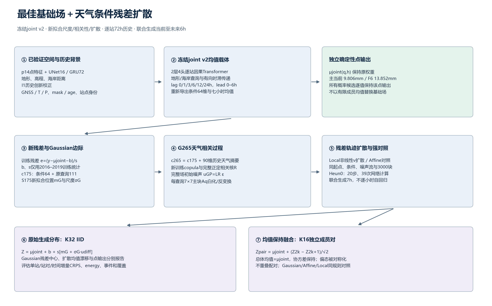
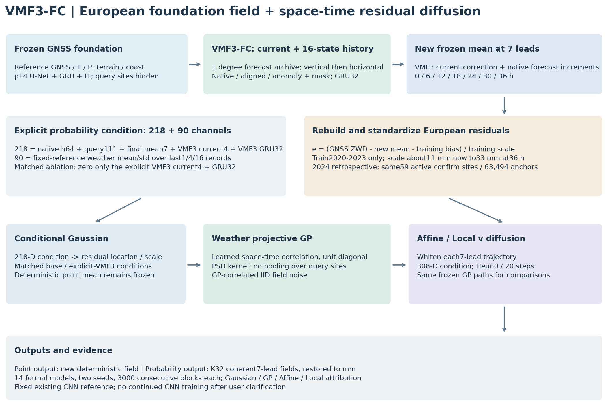

# 现有架构：从条件站到确定性点场和随机场

模型读取可见参考站的全球导航卫星系统（GNSS）天顶湿延迟（ZWD）、温度T、气压P、缺测状态及静态位置条件，查询隐藏位置的当前ZWD或未来轨迹。背景、创新、时间预报与随机残差各有明确输出；最终统一恢复为mm。

## 1. 符号与输入输出

| 符号 | 含义 |
|---|---|
| t，h | 预测起点和预报时效；美国h=0,…,6h |
| q，i | 任意查询位置和可见条件站 |
| y(q,t+h) | 训练/评分用目标ZWD，隐藏目标标签不进入推断条件 |
| μ(q,t,h) | 作为点预测交付的确定性均值载体，单位mm |
| bₕ，sₕ | 训练残差的中心与正尺度，按原实验统计恢复物理单位 |
| mG，σG | 条件Gaussian学习的标准化残差位置与尺度 |
| R，η | 时空相关矩阵与由该Gaussian过程生成的相关标准噪声 |
| Z⁽ᵏ⁾ | 第k个随机场成员，含全部查询及七个时效 |

美国输入截至t，未来标签的mask用于监督和评分。新路线不以PWV/IWV/TCWV/Tm作条件或教师。训练、开发及隔离站的角色遵循原实验锁；标签制包与站点筛选谱系见[结果入口](README.md)。

## 2. 美国确定性路径

### 2.1 p14：点特征与固定支撑区域上下文

查询点的113维特征经宽度128的多层感知机（MLP）读出；30通道固定支撑图经U-Net16提取区域修正。既有GRU72通过8×8内部历史支撑接入，地形与海岸关系参与背景融合。点路径保留实际查询坐标及站高相对DEM的差异，U-Net路径提供区域上下文。监督来自GNSS站点标签，插值支撑图是内部表示。

这套架构允许坐标查询，但内部仍有固定格网和支撑图。任意查询能力表示输出不绑定一组固定像素，不等于全部空间信息无损，也不等于整模型完全没有格网。输出分辨率和已验证空间精度需要各自评价。

### 2.2 I1：观测创新修正

对可见站计算同位置、同时间的背景误差

$$r_i(t-\ell)=y_i(t-\ell)-\mu_{\mathrm{bg},i}(t-\ell),\quad \ell\in\{0,1,3\}\mathrm{h}.$$

按3km高差尺度输送创新，在50/150/300km三个软核尺度上聚合。三个滞后乘三个空间尺度形成9维查询特征，由训练池拟合的岭回归头输出限幅±5mm的修正：

$$\mu_{I1}(q,t)=\mu_{\mathrm{bg}}(q,t)+\delta_{I1}(q,t).$$

美国当前重建保留这一输出。I1的未来持久性参考把同一个起点值延伸到各h，用于衡量新增未来预测信息。

### 2.3 原生逐站时序编码

每站每时刻的32维输入包含15维动态量、9维静态量和8维身份嵌入。动态量保留GNSS/T/P、三变量mask/age、背景及I1后创新、日/年时钟；静态和查询关系保留高程、地形、海岸及几何条件。逐站32→64投影后，因果Transformer使用2层、4头、FF128、dropout=0，保留每个历史时刻的key。

72h表示新编码器的状态窗口；由于上游背景与创新也需要历史，底层原始数值依赖跨度为146h。缓存由条件站集合、时间范围与源模型共同定义，同一历史窗口保留同一条件布局。查询111→64，以50/100/200/400km四尺度注意力接收站点历史；显式物理创新读出与6×3站点增量辅助监督共同约束编码。

### 2.4 joint v2：有向站点–时滞–时效传递

joint读取0/1/3/6/12/24h历史key。8维地理关系、lag和lead进入10→32→4边MLP，四个头学习有方向的传播权重。显式数值路径传递I1后创新、ΔGNSS、ΔT和ΔP；每个变量按自己的有效mask集合归一，高差、地形及海岸关系参与查询。

当前/未来新增修正限幅3/6mm，新增读出以零初始化。总体确定性输出写为

$$\mu_{\mathrm{joint}}(q,t,h)=\mu_{I1}(q,t)+\delta_H(q,t,h)+\delta_{\mathrm{directed}}(q,t,h).$$

δH为原时序载体的校正，δdirected为新增有向分支；原载体当前/未来头限幅5/30mm。新校正载体117757参数，不含冻结背景、GRU和I1来源。factorized对照与joint同参数、同起点、同预算，但joint同时改变历史key读取与非可分离边评分，现有直接证据对应二者的组合。

v1的缺测归一化问题及停止证据保留；当前结果采用每变量稳定归一的v2。六小时预报选joint，当前重建按合并评价选I1，两种选择各自有证据来源。

## 3. 美国概率路径：先冻结点场，再学习匹配残差

### 3.1 条件接口与标准化

最新融合以冻结joint为残差来源。概率网接收64维查询状态和111维原始查询条件；天气GP及Local另接90维固定可见站历史天气摘要。天气摘要由可见条件站构成，不依赖同时请求多少查询点。

64维状态在显式物理创新及有向读出之前生成。最终七时效预测已用于定义残差和恢复物理单位，但其数值、有向分支修正及注意力统计没有作为额外独立通道直连本轮美国概率网。这是现有接口状态，对新增直连收益尚无正式消融。

按训练残差拟合b和s，并定义

$$e(q,t,h)=\frac{y(q,t+h)-\mu_{\mathrm{joint}}(q,t,h)-b_h}{s_h}.$$

S175学习条件位置mG和尺度σG；G265在相应条件上学习半正定、单位对角的空间–时间相关R。前者决定边际位置与尺度，后者决定同起点不同查询和时效如何一起变化。

### 3.2 Gaussian、Affine与Local怎样生成

天气GP生成相关标准噪声η。对每个查询的七时效轨迹，模型在7×7相关块上白化；Affine或Local对该轨迹进行v速度传输，再着色恢复。v表示训练的速度参数化。Affine提供同预算仿射控制，Local提供局部非线性变换，二者使用同源Gaussian噪声路径。

用T表示着色后标准轨迹的整体变换，物理输出为

$$Z^{(k)}=\mu_{\mathrm{joint}}+b+s\left[m_G+\sigma_G\,T(\eta^{(k)})\right].$$

乘法按查询/时效逐项进行。标准化和白化组织训练尺度及相关性；还原后所有点值、CRPS与差值评分均回到mm。原始Local/Affine采用Heun0轨迹采样；最新主表为K32成员。

### 3.3 点输出、概率中心与有限成员均值

确定性点输出为冻结μjoint；概率分布的总体均值还受b、mG和T影响。有限K成员平均又包含Monte Carlo采样误差。因此保存点场、概率解析/总体中心和成员样本均值是三个不同对象，分别报告。

严格保持joint总体均值时，使用两个条件独立、同分布的完整生成场Z与Z′：

$$Z_{\mathrm{pair}}=\mu_{\mathrm{joint}}+\frac{Z-Z'}{\sqrt{2}}.$$

若二阶矩存在，该变换总体均值为μjoint，协方差等于原Z，并使分布中心对称。32个原始成员以不重叠成对方式产生16个新成员；所有站点及时效使用相同配对。其有限K16样本均值仍有采样方差。这与将同一成员集合减去样本均值不同，后者改变成员独立性与有限集合分布。

最新raw Local主/补F6 CRPS 7.657557/8.750280mm来自K32。K16中心保持版本有自己的配对评分，概率总体均值保持的数学性质不替代其实际CRPS、时间增量和空间差值结果。

### 3.4 起点内联合场与跨起点序列

每次起点生成同一噪声路径下的多查询、七时效联合场；滚动起点间独立采样。输出可用于起点内站对差值、轨迹增量和联合能量评分，跨起点拼接后的长序列一致性属于另外的评价对象。

## 4. 欧洲：VMF3-FC新增物理背景

### 4.1 记录与背景处理

欧洲使用实际6h UTC记录，16记录历史跨度90h，七时效为0/6/12/18/24/30/36h。沿用273训练站、64开发站、63注册确认站和11新站的1km物理站址隔离；2024共同有效评价为59确认站、63494键。欧洲地形来自原ERA5静态地形的粗载体，与美国地形来源分别记录。

VMF3-FC 1°归档先在四个格点分别做Kouba高程修正，再双线性查询。三个物理特征为native ZWD、与本模型干湿口径对齐的aligned ZWD、aligned与原I1的差。aligned所需气压由可见参考站T/P经干空气高程输送及空间加权估计。目标站GNSS/T/P及湿度柱信息不进入新条件。缺测原始背景保留mask。

### 4.2 当前均值融合与未来锚定

冻结p14＋GRU＋I1后，校正器接收原111维查询条件，以及16记录VMF三特征/mask的GRU32状态。相同结构的control将VMF输入置零，用于区分新增校正器与新增物理信息。

未来增量保留欧洲原因果Transformer的预测，以新的当前VMF均值作公共锚点：

$$\mu_{\mathrm{new}}(t,h)=\mu_{\mathrm{joint}}(t,h)-\mu_{\mathrm{joint}}(t,0)+\mu_{\mathrm{VMF}}(t,0).$$

本轮使用当前及历史可映射背景，没有接入未来VMF有效时刻。归档发布时间尚未逐文件追溯，因此年度结果定位为历史回看。

### 4.3 欧洲概率网的显式条件

概率查询为218维：64维查询状态＋111维原条件＋7维最终均值＋VMF当前三特征/mask共4维＋32维VMF GRU状态。另加固定参考站15维状态在1/4/16记录上的均值/标准差共90维。美国本轮尚无的最终均值显式接口在这里已接入。

训练残差按新μnew重新拟合b、s，复用Gaussian、天气GP、Affine/Local与Heun0。物理输出仍为

$$Z=\mu_{\mathrm{new}}+b+s\left[m_G+\sigma_G T(\eta)\right].$$

base与vmf两组概率模型共享同一个新VMF确定性场；base将额外VMF4维和GRU32维置零。该比较检验额外显式概率条件，不能解释为整个系统有/无VMF。

## 5. 代码与原始证据

现有核心包在[src/gnss_field](../src/gnss_field)，研究实现保留在[research/engine/tools/terrain_diffusion](../research/engine/tools/terrain_diffusion)。整理只改变入口和目录组织，历史来源锁及实验参数继续对应原记录。

| 路径 | 对应职责 |
|---|---|
| [fixed_support.py](../research/engine/tools/terrain_diffusion/fixed_support.py)、[p14_fusion.py](../research/engine/tools/terrain_diffusion/p14_fusion.py) | 固定支撑、点读出及背景融合 |
| [innovation_refinement.py](../research/engine/tools/terrain_diffusion/innovation_refinement.py) | 历史创新校正 |
| [native_weather_models.py](../research/engine/tools/terrain_diffusion/native_weather_models.py) | 逐站因果状态与均值模型 |
| [native_directed_lag_v2.py](../research/engine/tools/terrain_diffusion/native_directed_lag_v2.py) | 有向站点–时滞传递与变量mask归一 |
| [native_weather_gp.py](../research/engine/tools/terrain_diffusion/native_weather_gp.py)、[native_weather_gp_diffusion.py](../research/engine/tools/terrain_diffusion/native_weather_gp_diffusion.py) | 天气相关核、白化轨迹与生成 |
| [美国最新融合报告](../experiments/us/20261126_best_base_diffusion_fusion/paired/REPORT.md) | raw K32、中心保持K16、概率归因与区间 |
| [欧洲VMF完整报告](../research/europe_vmf3_20261126/REPORT.md) | 欧洲实现、点场与概率直接对照 |

原始数据、权重和大型数组保留本地。美国抽样开发、欧洲年度回看、严格折外残差状态与历史筛选谱系见各报告，架构功能和实际可支持的贡献由[模块证据矩阵](MODULE_CONTRIBUTIONS.md)对应。
