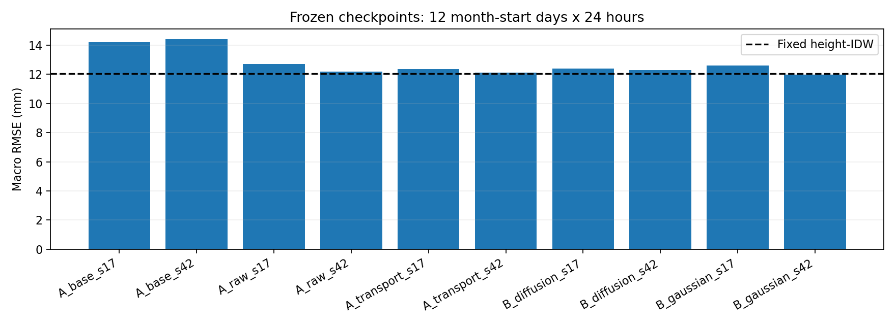
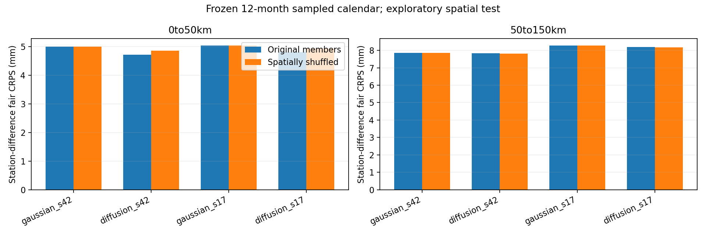
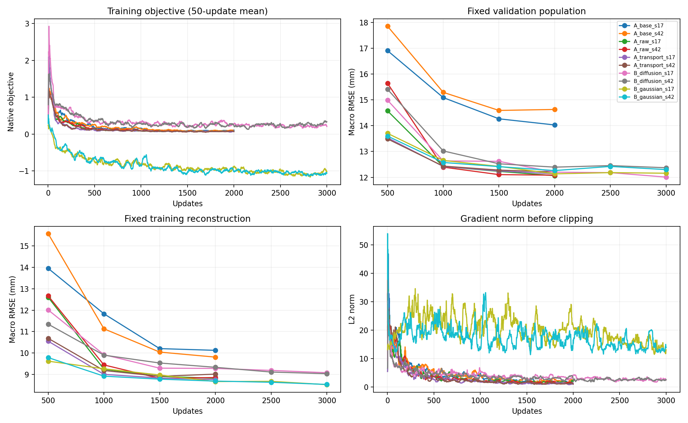

# v11 实践结果：观测编码改善点值，扩散呈现局地空间关联

完成日期：2026-11-24。10组本机训练，共24,000次参数更新；六组确定性编码对照与四组概率模型均完成。结果支持继续研究局地空间联合生成，同时把下一轮点值优化集中到空间支持分布与查询一致性。

## 1. 评价人口与比较口径

沿用美国西部最新允许变量QC合同：训练410站、验证137站；2016/2017共72个训练窗口。模型条件为稀疏站ZWD、T/P和静态几何，保留12小时可观测条件历史，训练与推理均无目标站历史。不输入PWV/IWV/TCWV/Tm，也没有v04均值背景或插值教师。确认138及原C/D标签未读取。历史站点队列仍受到早期PWV完整率筛选影响。

选模为2018年1/4/7/10月1日前4小时、3种固定观测布局；冻结权重后扩展到12个月月1日、每段24小时，每布局288小时。扩展集与选模集部分重叠，属于开发期稳定性检查，并非完整逐小时全年或独立盲测。宏RMSE先按站计算，再对布局和种子平均；概率结果用fair CRPS，越低越好。B选择与扩展均K16，另以K32扩散/解析高斯复核C门槛。

## 2. 配对结果

| 方法 | 选模宏RMSE/mm | 扩展宏RMSE/mm | 扩展CRPS/mm |
|---|---:|---:|---:|
| 原查询编码 | 14.309 | 14.307 | 10.977 |
| 多尺度原始观测编码 | 12.074 | 12.456 | 9.703 |
| 高差传输编码 | 12.172 | 12.231 | 9.397 |
| raw＋高斯 | 12.198 | 12.285 | 6.668 |
| raw＋扩散 | 12.190 | 12.339 | 6.784 |

确定性方法的K1 CRPS等价于绝对误差，不应把它与生成模型的下降直接解释为分布质量增益。相同人口下，固定高程尺度3000m的IDW在选模/扩展范围分别为11.662/12.066 mm；直接地表IDW分别为17.046/18.062 mm。

A组raw在选模窗口两个种子均超过base，按预先指定规则选中进入B；扩展日历上transport均值更好，未据此回改选择。相对配对base，raw扩展宏RMSE改善12.9%，transport改善14.5%。高差传输在海拔1500m以上31站上达到10.73/10.53 mm，raw为11.07/11.64 mm；低于500m的55站则raw更好，表明高程传输需要区域适应，而非统一强度。

B每个模型继承对应2000步raw编码器，并额外训练3000步。A与B预算不同，不能把差异全部归因于生成目标。高斯与扩散拥有相同预训练和新增预算。扩展范围扩散平均12.339 mm、高斯12.285 mm；本轮尚未达到8 mm，也没有稳定超过高程IDW。

## 3. 生成式模型的可保留机制

对137个不同物理组的验证站构造站间ZWD差值，0–50km共有720站对。扩展范围高斯两种子差值CRPS为4.997/5.033 mm，扩散4.720/4.805 mm，平均改善5.0%。保持每站所有成员取值完全不变，逐站独立打乱成员编号后，扩散差值CRPS增加0.135/0.131 mm；高斯变化约0.001 mm。这支持扩散已经学到对局地差值分布有益的空间对应。

50–150km的519站对上，扩散打乱后反而改善0.029/0.026 mm，远距离相关结构还需校准。此结果为选模结束后的探索性分析，3次shuffle重复不是置信区间；站对之间也非独立样本。它验证观测站对的联合变化，不等价于无人测量格网上的细尺度精度。后续应在锁定距离分箱与独立时段上复核，并加入相关高斯对照，区分一般空间协方差与扩散独有贡献。

## 4. 训练动态与主要卡点

训练正常产生收益，没有出现整体发散。raw在最后500步的验证RMSE分别改善0.022/0.166 mm，固定训练误差约8.85/8.82 mm，验证约12.08/12.06 mm；主要进步发生在前1000–1500步。扩散2000→3000步的验证RMSE改善0.023/0.191 mm，仍有学习空间，但不足以支持直接外推至8 mm。高斯2000步后固定训练误差继续下降，验证轻微回升，存在局部过拟合迹象；扩散尚不能统一判为过拟合。

图中不同模型的原始loss尺度不同，Gaussian负NLL可以为负，不能跨目标比较数值高低。梯度裁剪触发率：raw约82–83%，transport约75–77%，扩散约93%，高斯100%；高斯裁剪前梯度中位数16.7/19.4。高裁剪率说明训练受裁剪影响，但本身不证明梯度爆炸或错误。若调整裁剪/学习率，应单独配对测试，并记录实际参数更新范数，不能凭该曲线直接放大阈值。

最明确的输入分布差异来自空间支持：重放457,000个训练目标，最近有效观测距离中位数39.69km；验证为77.93km。超过100km的比例从18.64%升到32.67%。训练常能使用更近的观测，验证更接近空间外推。此统计提示优先检验空间空洞抽样，尚未证明它是全部误差的因果来源。

另一卡点是查询一致性：同一确定性网络仅把查询数64扩至137，raw输出RMS变化2.43/1.98 mm，transport1.20/1.26 mm。二者查询数均在训练范围内。新的观测摘要本身逐点不变，但后续目标图交互仍依赖查询列表。因此任意点场产品应考虑固定支撑图＋逐点读出，并保持发布与评价算子一致。

## 5. 阶段C决定与下一步优先级

C门槛复核使用冻结权重、独立噪声、K32扩散，以及解析高斯均值/CRPS。扩散两种子CRPS为7.041/6.877，高斯6.829/6.810 mm；扩散相对A点值差为+0.238/−0.109 mm。两种子均未满足全部条件，因此本轮C自生成历史训练不启动。概率收益明确解释为“超过配对高斯且两种子成立”，以及K32复核，是B期间经审查补充的裁定，未冒称全部预注册。

下一轮建议按顺序建立独立假设，每次两种子、相同预算：

1. **空间空洞训练。** 保留raw/transport，比较随机遮站与地理块遮站；依据训练池几何设计多距离层抽样，记录距离和高差分层RMSE。目标是提高远离条件站时的重建能力。验证分布已用于诊断，后续仍属于适应性开发。
2. **固定支撑图与查询读出。** 让查询位置读取固定条件/隐支撑节点，取消查询点之间影响输出的路径；比较64/137/整格网/分块查询的数值一致性，同时检查精度代价。
3. **局地相关生成。** 在前两项稳定后比较独立高斯、相关高斯与扩散；把站对差值CRPS与点值CRPS同时锁定为评判项，限制远距离错误关联。增加时间关联作为单独假设测试，而非把当前空间证据当作时序证据。
4. **小预算延训对照。** 保留原抽样作为控制，与空间空洞模型使用相同额外更新数，回答收益来自训练时长还是抽样机制。暂不投入全量训练。

本轮随小时更新可观测条件，未训练目标自生成历史，也不是24小时预报。连续场演变仍是下一阶段任务。

## 6. 可复核材料

- `summary.csv/json`：十组点值与概率结果；`terrain.csv`：高程分组。
- `history.csv`：各运行逐步日志；`config.json`及检查点哈希：运行依据。
- `spatial_shuffle_all_months24.json`：扩展空间检验；`support_distribution.json`：支持距离。
- `query_expansion64.json`：查询一致性；`C_gate.json`：阶段决定。
- `artifact_audit.json`：20组保存预测的指标与增量复算、原始标签及哈希核验；`gate_audit.json`：4组门槛复核。
- [代码与训练协议](../../tools/terrain_diffusion/V11.md)；[审查记录](REVIEW.md)。权重和预测数组保留本机，轻量文件同步GitHub。
