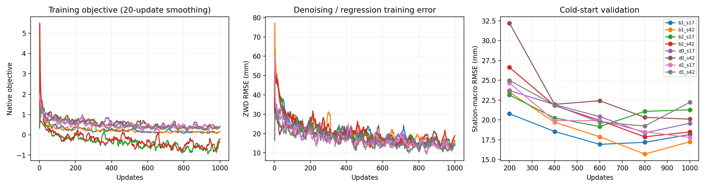
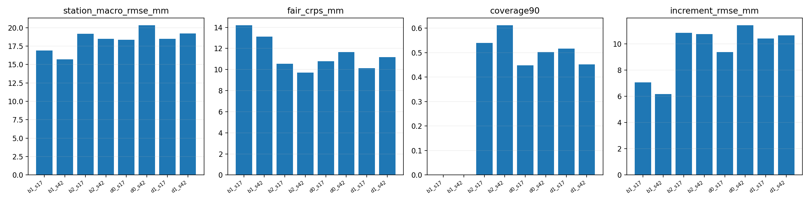
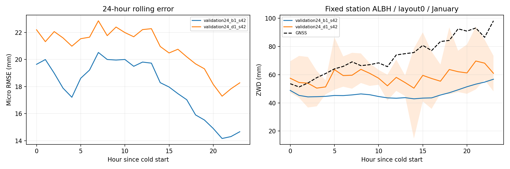

# v10 地形时序图扩散：实现与真实本机筛查

状态：**P0/P1工程验证与两种子缩减筛查完成；正式P2、P3及全量训练待推进。**

已构建直接地表ZWD图扩散、条件因果Transformer、生成历史GRU、MAE式遮站编码器迁移，以及完整可微的4小时生成损失。网络384,682参数。代码、训练命令与后续预算见[训练说明](../../tools/terrain_diffusion/README.md)。

## 真实数据与评估人口

允许变量QC直接从547个原始测站文件重建，只使用ZWD/T/P。410训练站提供2016/17的72段数据；137验证站提供2018月1日标签；138确认站及原C/D标签未读取。训练缓存有效率97.97%，验证标签有效率97.86%。原始队列继承历史PWV完整率筛选，记录层独立QC不改变这段站点选择历史。来源时制字段本次为UNSPECIFIED，统一按产品名义小时对齐。

每组条件站82个，三种固定布局。当前选模窗口为2018年1月和7月1日前4小时，137个验证站，K4。表中先对三个布局等权平均，再对种子42/17等权平均。确定性模型按RMSE选点，概率模型按fair CRPS选点。旧v04约9mm采用不同站点人口与输入协议，不能直接与本表比较。

| 模型 | 每种子更新 | 宏RMSE / mm | fair CRPS / mm |
|---|---:|---:|---:|
| B1 同编码器确定性模型 | 1000 | 16.299 | 13.647 |
| B2 条件高斯模型 | 1000 | 18.820 | 10.126 |
| D0 从头训练直接扩散 | 1000 | 19.338 | 11.211 |
| D1 迁移遮站编码器＋直接扩散 | 1000，另有B1预训练成本 | 18.860 | 10.654 |

D1的平均CRPS比D0低约5.0%，但种子17的宏RMSE略高于D0；高斯对照的平均CRPS更低。三种概率分支均未达到相对B1宏RMSE恶化不超过0.2mm的候选门槛。当前没有达到8mm，也没有证据把扩散模型列为精度优胜者。

左图各模型使用各自损失，数值不作跨目标比较；中图为随机训练批的恢复误差，扩散包含随机噪声级别，不等同于无噪推理RMSE；右图为同人口的冷启动验证。概率模型最终选中步可能不是右图RMSE最低点。

确定性模型的集合退化为单点，coverage=0与width=0用于区分输出类型，不用于评价概率校准优劣。K4区间主要用于筛查，正式概率验证需增加集合规模。

## 24小时连续生成

对种子42的B1与D1，额外使用独立噪声种子19007、K8、两个完整24小时和三布局，保持137目标站固定。结果为：B1宏RMSE16.606mm、CRPS13.346mm；D1宏RMSE19.801mm、CRPS11.992mm。

D1的一小时增量CRPS为3.806mm；逐小时独立打乱成员编号后为4.281mm，增加0.475mm。这个单种子诊断支持继续检验成员时间关联。它不证明细尺度天气过程已被正确恢复，后续需要两种子、更多月份及高斯对照的同口径时间检验。

右图固定为元数据顺序首站ALBH，不按误差挑选。全程使用成员自身历史，没有验证站真实历史暖启动。图中既有概率演变，也显示该站趋势幅度尚需改善。

## 工程验证

- 12项测试通过：允许列独立QC、角色访问隔离、v参数反演、因果性、目标置换、采样梯度、已知人口指标、时序梯度、非有限预测拒绝、全小时缺测、权重来源、报告数据合同及隐藏标签隔离等（多个性质在同一测试内）。
- 两段真实小样本、300更新：前50步平均训练恢复误差21.018mm，后50步10.313mm。该数值是随机噪声训练诊断，不是留站RMSE。
- 完整4h × K4 × DDIM20、16目标和82条件站：前后向7.68秒，峰值显存1920.4MiB，梯度有限。没有截断主轨迹历史梯度。硬件RTX4060 Laptop GPU。
- 8组已保存预测重新计算，主指标最大差为0，全部预测有限，真实评价人口完全一致。见[核验](screen/audit.json)。
- 独立实现审查的四项问题已修复，见[审查记录](REVIEW.md)。原始数据、权重与预测数组保留本机；公开仓库同步代码、配置、指标、曲线及来源合同。

## 下一轮训练安排

下一步优先完成正式P2的共同条件，而不是直接进入全量训练：扩展目标数至64–160、加入空间均衡与空洞遮站、记录站点抽样覆盖；先比较这些改动对B1和D1的共同影响。正式预算为B1/B2各2000步、D0/D1各3000步，单独1000步遮站预训练，种子42/17；评价扩展12个月24小时、K16/32，并补齐地形与距离分层。

在表示与点值误差有稳定进展后，使用已有 `--temporal` 路径进行4h × K4 × DDIM20的200–500步微调。完整链已证明本机可执行；本轮未把一次梯度测试计为时序微调实验。微调同时检查ZWD CRPS、增量CRPS、macro RMSE、覆盖率和成员打乱，保留B2概率对照。

本轮原型选择：32查询、随机条件布局、固定学习率、EMA0.95、FP32；条件图最近12点、均值/最大值全局摘要、无支撑时最近点回退；地形为现有25km最近节点。这些简化使本机筛查可复现，但还没有检验正式方案的空间混合抽样和更丰富的边消息机制。当前注意力内部为稠密矩阵加邻接掩码，大规模高分辨率查询需要真正的稀疏算子；不能用独立小块采样替代联合场。海岸距离、密度敏感性、查询集扩展与72小时滚动列入后续验收。
