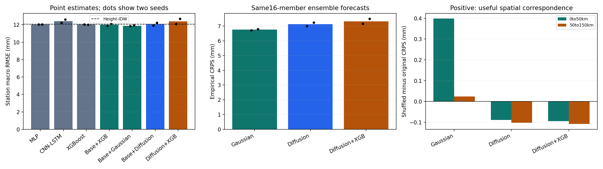
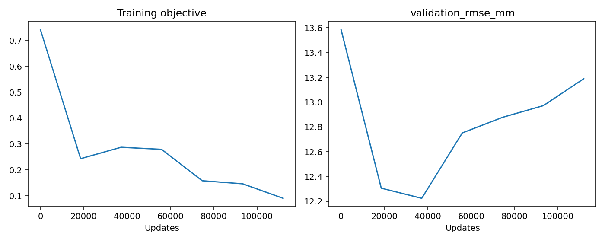
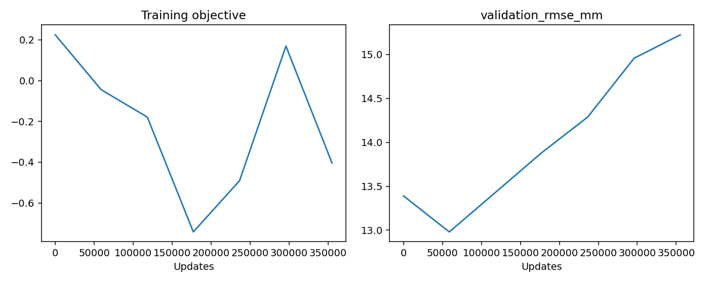

# v12 夜间实验：基础场残差可校正，扩散的联合分布仍需改进

2026-11-24。E1201–E1207七组、两个随机种子全部完成；共32次模型拟合，神经网络累计2,102,586次参数更新。四类神经模型各消耗约1小时训练预算，树模型按监控误差提前停止，主队列含评价共4小时12分34秒。全部曲线、检查点、指标与图像已保存。E1208为冻结权重的采样核查，不增加训练。

本轮支持继续采用“较强基础场＋留出残差建模”。当前最稳定的点值与概率收益来自相关高斯残差管线。扩散能够修正基础场点值，但其分布偏窄，近邻空间对应没有体现v11直接扩散的优势；后接XGBoost也没有带来改善。因此，下一阶段应先修正残差分布学习和选模协议，再扩大网络或训练时长。

## 数据和评价范围

沿用美国西部最新允许变量QC合同：410训练站、137验证站，82个条件站，2016/2017共72个训练窗口；条件为可观测GNSS ZWD、T/P、地形和12小时因果历史。没有PWV/IWV/TCWV/Tm条件或教师。确认138及原C/D标签保持隔离，历史站点队列的PWV完整率筛选影响仍保留。

基础场采用相同缓存：512个训练事件，50%随机遮站、50%空间空洞条件布局，每事件最多128目标。实际拟合部分有54,656个有效目标条目，可能包含重复站时。一小时训练是在这些缓存事件上反复优化，不等于增加到完整年度数据。150km空间块划为三折，留出折同时从条件和监督中排除，再生成该折残差。标准化沿用训练410站合同，并非逐折重新估计。

主选模窗口为2018年1/4/7/10月1日前4小时×3布局；冻结后扩展到12个月月1日各24小时×3布局，137站、115,386个有效布局—站时条目。扩展范围不是完整逐小时全年，且与选模窗口部分重叠，属于开发评价。

## 主结果：原定K16口径

下表先按站计算RMSE，再对三个布局与两个种子平均。确定性模型K1，概率模型K16。

| 编号 | 方法 | 选模宏RMSE/mm | 扩展宏RMSE/mm | 扩展fair CRPS/mm |
|---|---|---:|---:|---:|
| E1201 | 多尺度MLP基础场 | 12.991 | 12.041 | 9.290 |
| E1202 | 径向CNN-LSTM基础场 | 12.986 | 12.401 | 9.557 |
| E1203 | XGBoost基础场 | 13.306 | 12.020 | 9.206 |
| E1204 | 基础场＋XGBoost残差 | 13.067 | 12.002 | 9.297 |
| E1205 | 基础场＋相关高斯残差 | 12.789 | 11.880 | 6.389 |
| E1206 | 基础场＋残差扩散 | 12.562 | 12.055 | 6.874 |
| E1207 | 残差扩散＋XGBoost后校正 | 12.689 | 12.386 | 7.074 |

同人口固定高程IDW为12.066 mm。当前没有达到8 mm。K1的CRPS等于绝对误差；概率比较主要看E1205–E1207。E1207的共同修正依赖整个集合的均值和标准差，成员不再条件独立，因此fair CRPS作为描述性评分，并同时报告不依赖独立成员假设的经验CDF CRPS。

三种概率管线的经验CRPS分别为6.755、7.121、7.321 mm，与fair CRPS的排序一致。E1206→E1207的共同平移保持成员间差值，因此这两种CRPS的变化量相同，后校正没有改善的判断不依赖评分修正项。

## 基础场选模：微小优势不代表稳定排序

预先指定的季度平均RMSE选择了CNN-LSTM：12.9864 mm，MLP为12.9909 mm，相差0.0045 mm。因此E1204–E1207统一使用CNN-LSTM，未用扩展结果回改基础场。扩展日历中，MLP和独立XGBoost分别为12.041和12.020 mm，均优于CNN-LSTM的12.401 mm。

这次排序变化说明短选模窗口对天气片段敏感。CNN-LSTM在小时变化绝对误差上更好，但当前不能据此声称总体点值优势或随机序列建模优势。下一轮应先扩充内层选择的天气过程，并设置独立时间检查，再比较复杂架构。

## 残差校正的收益与位置

本轮隔离比较校正与生成：E1206直接读取CNN-LSTM基础场，不读取E1204的修正输出。在同一CNN-LSTM基础场上，XGBoost残差回归将扩展RMSE由12.401降至12.002 mm，相关高斯残差降至11.880 mm，残差扩散为12.055 mm。相关高斯的条件均值校正与概率目标尚未通过同结构MSE对照分离，因此点值收益不能全部归因于随机生成。

扩散后再接XGBoost，两个种子的扩展RMSE从11.892/12.219升至12.095/12.677 mm。校正器在自己的留出时间监控上，微RMSE由13.648/13.691降至13.430/13.473 mm，却未迁移到137验证站。校正拟合只有4,732个有效条目，监控2,357个，且其基础预测来自空间折模型，部署基础预测来自全池重拟合模型；有限校正人口和这种分布差异是需要检验的解释，当前不是已证实的唯一原因。

高程分组显示，1500m以上31站的XGBoost残差方案约10.393 mm，相关高斯约10.552 mm；低于500m的55站仍约12.7–12.8 mm。当前误差主要不能归结为“高山全部建模失败”。完整分组见terrain_diagnostics.csv。

## 扩散分布与空间联合变化

在同为K16的情况下，相关高斯90%样本区间覆盖约76.6%，扩散约58.8%；对应区间宽约29.2和19.7 mm。有限集合的样本分位数本身有覆盖偏差，不能把K16覆盖率直接视为解析分布覆盖率。相关高斯解析90%区间覆盖85.4%/85.2%，仍需校准；扩散相对偏窄的结论在同成员数比较中成立。

50km以内720站对的差值CRPS，相关高斯两种子为4.380/4.378 mm，扩散为4.546/4.628 mm。逐站打乱成员编号、严格保持每站边际样本后，高斯评分增加0.386/0.411 mm；扩散反而降低0.121/0.058 mm。这版残差扩散没有延续v11直接扩散的局地关联收益。50–150km的结果也未支持扩散当前的成员对应。该诊断使用一次固定打乱，属于探索性机制检验，不是独立样本显著性检验。

扩散的一小时增量CRPS约3.529 mm，低于高斯约4.297 mm。但两者都没有训练跨小时随机状态，扩散更窄的边际分布也会影响增量评分；这一数值不能解释为已经学会连续随机天气演变。

## 训练曲线：已有清楚的后期过拟合信号

高斯与扩散的两个种子均按CRPS选中了约300秒的检查点。高斯末期验证CRPS升至8.268/9.612 mm，扩散升至9.307/10.505 mm；训练目标总体仍在下降。固定训练诊断进一步确认：高斯训练均值微RMSE从11.730/11.575降至9.930/9.654 mm；扩散在固定12事件、4个噪声级和相同噪声种子46123下，v预测MSE从0.588/0.576降至0.231/0.218。训练拟合继续改善而验证评分恶化，支持后期过拟合的判断。继续重复同一缓存的长训没有带来稳定收益。

高斯每种子约35.5万次更新、扩散约11.2万次更新；5分钟检查点已包含约5.9万/1.86万次更新。基础MLP与CNN-LSTM各有三折和最终拟合，不能把一次模型族的一小时误认为每个最终网络均独立训练一小时。

空间空洞抽样把训练最近条件距离中位数移到74.5km，接近验证77.9km；但训练75%分位数为262.7km，验证为109.6km，长距离尾部偏重。因此“中位数匹配”还不等于训练分布完全匹配。下一轮更适合控制空洞半径和距离分层，而非继续增大空洞。

## E1208 冻结采样复核

冻结复核全部完成，没有新增拟合或改变任何已选检查点。高斯使用解析均值与CRPS；扩散使用独立噪声种子12471，比较同一组采样的前16成员和全部64成员。后校正分别处理四组16成员再汇总，保持其输入统计量口径。

| 冻结方法 | seed42宏RMSE/mm | seed17宏RMSE/mm | 两种子均值/mm |
|---|---:|---:|---:|
| 相关高斯解析均值 | 11.580 | 11.670 | 11.625 |
| 扩散嵌套K16 | 11.900 | 12.235 | 12.067 |
| 扩散K64 | 11.775 | 12.109 | 11.942 |
| 扩散＋XGB首组K16 | 12.109 | 12.697 | 12.403 |
| 扩散＋XGB四组K16汇总 | 11.991 | 12.580 | 12.285 |

扩散K16→K64平均降低0.125 mm，fair CRPS由6.885降至6.876 mm。相关高斯解析CRPS为6.432 mm。增加采样降低了集合均值的蒙特卡洛误差，但这次复核没有改变方法排序，也没有达到8 mm；它不构成模型精度上限的估计。后校正集合内存在依赖，其fair CRPS仅作描述，经验CRPS已同步保存。

E1208_frozen_sampling/verification.json核对了8份保存数组与规范真值、复算宏RMSE和两类CRPS，并验证全部主检查点及本次引用权重哈希。

## 下一阶段建议

1. 保留基础场＋留出残差的分工，先补“同结构确定性残差MLP”对照，确定点值收益由什么产生；相关高斯作为强概率基线。
2. 扩充训练事件和内层选择天气过程，保留空间分块；把训练空洞距离尾部调到目标任务范围。采用早停或合适的学习率退火，减少重复缓存上的无效长训。
3. 由E1205的空间检验出发，优先测试带相关高斯先验的残差扩散：在空间相关噪声上学习剩余非高斯结构，同时比较固定/可学习相关高斯、白噪声扩散与相关噪声扩散。并检验残差尺度校准、观测空间概率损失和局地联合约束。是否有额外收益仍需配对实验，当前不优先继续叠加XGBoost后处理。
4. 基础场已经采用逐点独立读出；扩散仍有查询图依赖，连续场发布前需检验查询分块一致性。随机时间关联应独立训练和验证，不能由CNN-LSTM名称或较低增量CRPS代替证据。

## 可复核材料

- [协议、编号与命令](../../tools/terrain_diffusion/V12.md)
- [自动指标总表](RESULTS.md)；summary.csv记录逐种子与逐评价范围。
- 各实验/s42、s17目录保留训练曲线、检查点、监控日志、指标、站点误差地图和24小时例图；权重与预测数组在本机。
- artifact_audit.json复算28份主评估并核对规范真值；checkpoint_receipts.json保存32份检查点哈希，训练源码与运行合同一致。
- fixed_training_diagnosis.json、training_budget_actual.json、support_distribution.json、post_correction_diagnosis.json、ensemble_scores.csv及地形/空间/校准表保存补充证据。
