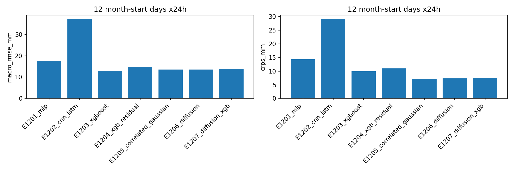

# v12 overnight residual field results

All experiments completed.

Training410/validation137; allowed ZWD/T/P only. Frozen confirmation138 and C/D unread. Three spatial-fold foundation predictions train downstream models; final foundations are refitted. Same2018 development calendar, not a blind test. Radial CNN-LSTM uses12h observable history; stochastic temporal coherence is not trained.

| Experiment | Macro RMSE/mm | Fair CRPS/mm | 1h increment CRPS/mm |
|---|---:|---:|---:|
| E1201_mlp | 17.6390 | 14.3417 | 4.1326 |
| E1202_cnn_lstm | 37.2020 | 29.1117 | 4.3864 |
| E1203_xgboost | 13.0650 | 9.9968 | 4.7676 |
| E1204_xgb_residual | 14.9288 | 10.9990 | 4.9304 |
| E1205_correlated_gaussian | 13.5666 | 7.1472 | 5.4699 |
| E1206_diffusion | 13.5582 | 7.3666 | 4.9420 |
| E1207_diffusion_xgb | 13.7513 | 7.4677 | 4.9612 |

K1 deterministic CRPS is MAE; probability arms K16 at expansion (matches post-calibration ensemble features). Independent selection K16. Baseline is selected by two-seed quarterly RMSE. Model-family budgets include its own fold fitting; downstream dependencies are extra cost. Trees can early-stop. Fixed spatial Gaussian covariance is a meaningful correlated baseline, not a learned temporal model. Diffusion has full point residual support but retains query-graph dependence. Post-XGBoost common correction preserves ensemble spread. Historical PWV station-cohort selection remains.

Source plan: docs/superpowers/plans/2026-11-24-residual-field-v12.md. Per-run folders contain metrics, curves, timing and checkpoints (weights/arrays local). Final interpretation to follow after frozen evaluations and diagnostic review.
