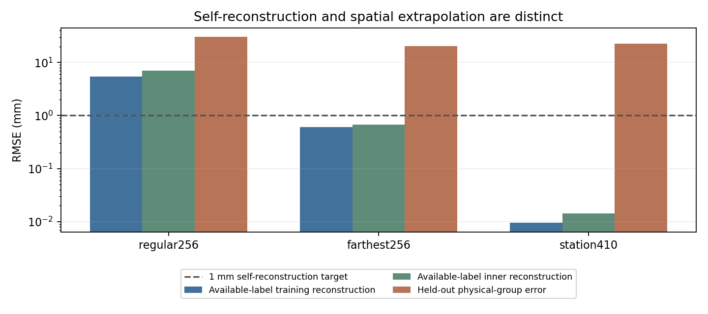
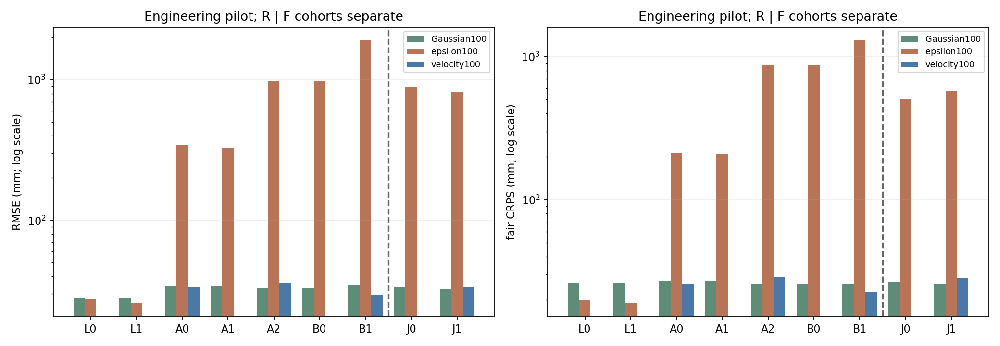
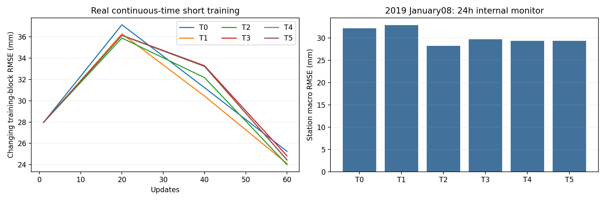

# 时空融合与谱残差：真实本机工程验证

完成T0–T5各60步、五折T5各60步、表示100步、九组概率模型及其Gaussian各100步，另完成四组v预测及Gaussian各100步。GPU为本机RTX4060，Python为Anaconda pytorch。此轮验证全流程与数值问题；未执行新架构3000步双种子正式比较。

训练基础场按2016–2018连续小时顺序；60步实际只消费最初360目标小时。残差缓存使用2016年1月8日起连续120小时，2019年1月8日起24小时诊断；5折的目标站集合不同，不合并成一个场。2020标签未参与拟合、选择或评分。

## 1. 表示瓶颈与改进

规则256锚点原配置的训练/2019自重构为6.854/8.615mm，遮标签误差17.249mm。仅降低正则到1e-6，自重构仍为5.344/6.916mm，说明误差并非全部来自正则。几何最远点256锚点在1e-4正则下为0.609/0.677mm，但按物理组留出为20.209mm；410站点锚点的自重构降至0.009/0.014mm，物理组留出仍为22.840mm。改进支撑几何能保留已观测残差，空间生成能力仍需另行学习。该支持审计是小试后的诊断，不回改A组成绩或作为2020选模。

## 2. 九组概率分支与数值稳定性

| 实验 | 任务 | epsilon100 RMSE | Gaussian100 RMSE | epsilon100 fair CRPS | v100 RMSE |
|---|---|---:|---:|---:|---:|
| L0 | R | 27.488 | 27.664 | 19.825 | — |
| L1 | R | 25.689 | 27.627 | 18.923 | — |
| A0 | R | 344.626 | 33.975 | 210.798 | 33.128 |
| A1 | R | 327.131 | 33.975 | 208.380 | — |
| A2 | R | 985.794 | 32.656 | 876.606 | 35.846 |
| B0 | R | 985.794 | 32.656 | 876.606 | — |
| B1 | R | 1914.790 | 34.450 | 1301.048 | 29.489 |
| J0 | F | 885.262 | 33.591 | 505.275 | — |
| J1 | F | 824.385 | 32.509 | 573.287 | 33.528 |

全部为mm。R为当前场重建，F为起点持久性均值上的未来6小时预测；两任务人口与信息条件不同。当前表示均未满足相应正式门槛，概率训练使用显式diagnostic覆盖，不能据此宣布新模型优于原p14。L1与L0的容量及训练状态也应在正式重复中匹配。

epsilon预测在高噪声端通过`x0=(xk−sqrt(1−a)*eps_hat)/sqrt(a)`重建，100步短训下误差会被很小的sqrt(a)放大；标准化本身不保证采样稳定。v对照使用`v=sqrt(a)*eps−sqrt(1−a)*x0`及无除小量的旋转逆变换。它检验数值参数化，不代表100步已经收敛或概率分布校准。

## 3. 实现与验证

- 修正时间16×16与p14大支撑的投影坐标对齐；首轮错误目录保留，v2已重训。
- LS按实际ZWD覆盖率掩码缺测，保存幅度、正余弦相位和覆盖率。
- 每层去噪token都对4×4空间记忆cross-attention；两域共用状态和噪声。
- 五折划分、目标来源小时、均值来源小时、文件哈希和诊断模式在入口校验。
- 综合收集测试时定位到旧test_fixed_support向sys.path插入子目录、遮蔽标准库profile的错误；改成包相对导入。第一次合并运行88项失败的原始日志保留，修正后另跑完整测试。

保存预测独立复算共26组，RMSE/CRPS最大差3.77604e-05mm。训练曲线、分层与站对误差见相应JSON；小时增量只在连续6小时块内计算，跨块首态重置。当前片段仅1月，夏季误差和全年结果尚无此轮证据。

## 4. 下一步实验调整

1. 基础场保持p14同起点、同数据条件比较，按3000步和12小时连续批覆盖训练年份，再完成双种子与季节诊断。
2. 使用几何适应锚点或站点锚点保留可观测残差；将自重构与物理组外推分开验收，引入局地残差消息与支持度条件，保持固定查询算子。
3. v预测作为稳定性候选，保留epsilon控制；在相同表示、步数、种子和Gaussian控制下比较CRPS、覆盖、增量及站对分布，避免仅看RMSE。
4. 增加连续时间缓存分片和季节覆盖，再做完整2016–2018残差训练、2019选择、锁定后2016–2019重拟合及2020开发评价。
5. J组补充经过训练的起点未来均值预测头；当前J仅是origin-persistence控制，尚无该头的效果。

[实现与全部架构图](../../../../../../../docs/research_notes/2026-11-25-joint-spectral-implementation.md)
