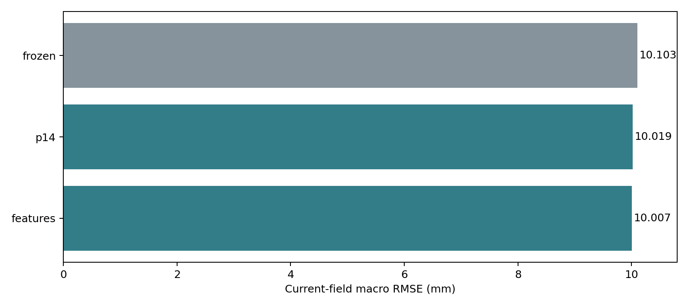
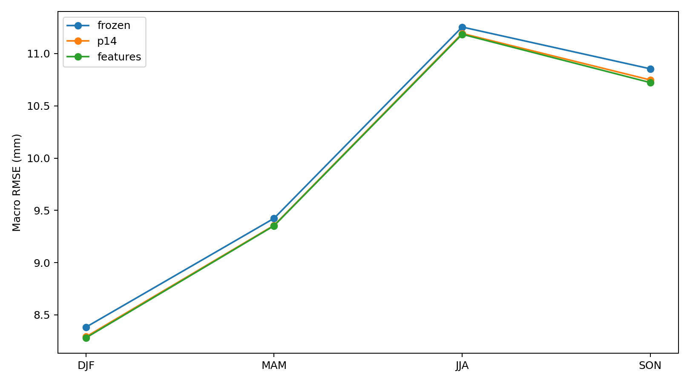
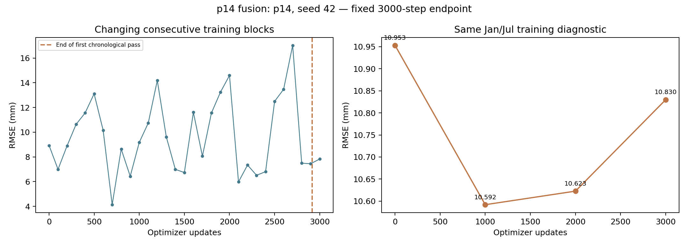
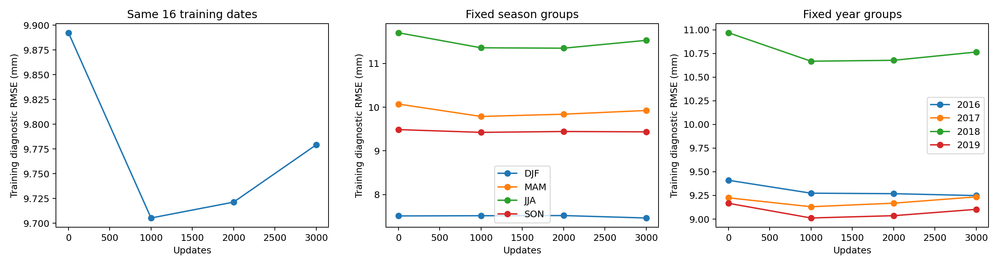

# p14与新空间特征及时间模块：连续3000步融合实验

状态：运行中，仅列已完成配置。原p14最佳两种子权重已恢复，旧2018合同指标精确复现。

任务为当前时刻空间重建；2016–2019按连续小时顺序训练，窗口内只抽样站点。每个配置固定3000步；主评价使用最终权重。
2020每月8–10日连续72小时、3布局，137登记验证站。时间模块在8×8潜场补充修正，保留原p14完整载体与113维点特征。
新空间特征组合包含海岸距离差、高差、坡度/粗糙度与相对位置边消息和FiLM；该组检验组合贡献，不单独归因于海岸距离。
无随机日期采样：34993个独立目标小时完整遍历一次，再重复开头996小时，共35989目标小时呈现。窗口历史72小时，块内12小时连续。
旧p14 support helper高程约定为复现权重保持；新边消息使用明确物理尺度。新时间分支的age来自完整因果时间轴，单独与成批处理一致。

| 组 | 已完成种子数 | 宏RMSE/mm | 微RMSE/mm | 小时增量宏RMSE/mm |
|---|---:|---:|---:|---:|
| frozen | 1 | 10.103 | 10.645 | 5.571 |
| p14 | 1 | 10.019 | 10.554 | 5.589 |
| features | 1 | 10.007 | 10.538 | 5.587 |

冻结基线与续训p14区分数据续训效应；features与续训p14比较新空间特征；时间组与features比较额外历史编码。
固定训练诊断曲线为事后分析，不作检查点选择；2020已开发暴露，不称盲验证。该阶段尚未训练diffusion。
指标复算、分季节/海岸/高程/地形、站对差值和配对区间分别见同目录JSON。权重和大型数组本地保留。

