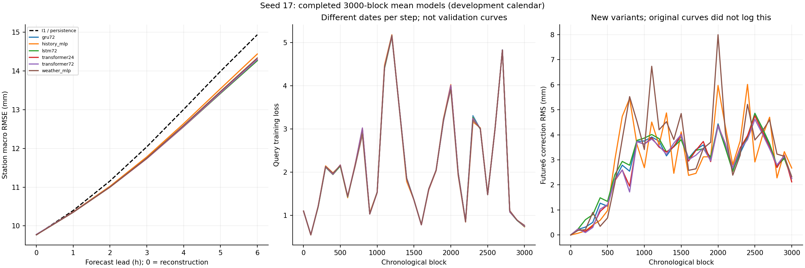
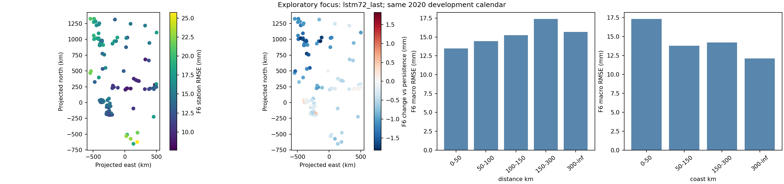

# 连续3000块均值模型比较

seed17，2020已暴露主日历。所有区间为月份配对开发回看，候选选择未作多重比较校正。

| 模型 | R/mm | F6/mm | R增量/mm | F6相对持久性95%区间/mm |
|---|---:|---:|---:|---|
| gru72_last | 9.777716 | 14.280271 | 5.525166 | [-0.8080, -0.4826] |
| gru72_ema | 9.777974 | 14.341587 | 5.533978 | [-0.7257, -0.4462] |
| history_mlp_last | 9.774857 | 14.436449 | 5.531630 | [-0.6717, -0.3224] |
| history_mlp_ema | 9.771773 | 14.507198 | 5.539102 | [-0.5655, -0.2820] |
| lstm72_last | 9.774612 | 14.263403 | 5.528145 | [-0.8268, -0.4949] |
| lstm72_ema | 9.775160 | 14.331049 | 5.536190 | [-0.7458, -0.4435] |
| transformer24_last | 9.775806 | 14.293620 | 5.534356 | [-0.7846, -0.4881] |
| transformer24_ema | 9.776334 | 14.351945 | 5.543755 | [-0.7122, -0.4448] |
| transformer72_last | 9.777525 | 14.293368 | 5.537893 | [-0.7858, -0.4813] |
| transformer72_ema | 9.778406 | 14.354201 | 5.546239 | [-0.7070, -0.4387] |
| weather_mlp_last | 9.768518 | 14.333601 | 5.537513 | [-0.7611, -0.4218] |
| weather_mlp_ema | 9.767641 | 14.419108 | 5.549184 | [-0.6344, -0.3801] |

## 六小时误差较高的站点

以当前已完成raw候选lstm72_last为例；负变化表示优于持久性。

| 站点 | F6/mm | 变化/mm | 高程/m | 海岸距离/km |
|---|---:|---:|---:|---:|
| PLTX | 25.725 | -0.628 | 271 | 47.8 |
| PTEX | 22.939 | -0.744 | 374 | 38.1 |
| P475 | 22.758 | -0.389 | 11 | 0.0 |
| P786 | 22.072 | -1.441 | 111 | 19.4 |
| P316 | 21.941 | -0.946 | 263 | 1.1 |
| P510 | 21.810 | -0.504 | 36 | 142.4 |
| PTAL | 20.925 | -1.061 | 109 | 6.1 |
| P472 | 20.330 | -0.307 | 172 | 14.2 |
| NANO | 19.964 | -1.156 | 24 | 3.3 |
| P398 | 19.320 | -1.183 | 46 | 1.0 |

全部六类分层、站对及来源哈希见[analysis.json](analysis.json)。
