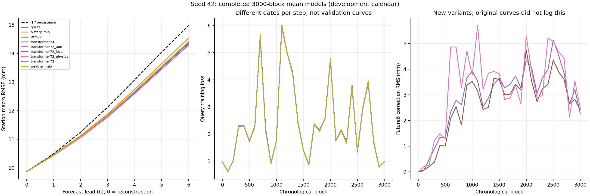
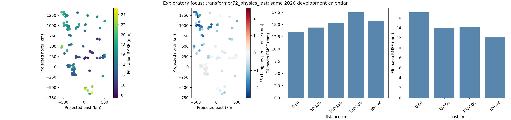

# 连续3000块均值模型比较

seed42，2020已暴露主日历。所有区间为月份配对开发回看，候选选择未作多重比较校正。

| 模型 | R/mm | F6/mm | R增量/mm | F6相对持久性95%区间/mm |
|---|---:|---:|---:|---|
| gru72_last | 9.865684 | 14.355185 | 5.523151 | [-0.7503, -0.4948] |
| gru72_ema | 9.870753 | 14.431602 | 5.528955 | [-0.6747, -0.4172] |
| history_mlp_last | 9.871648 | 14.537144 | 5.516032 | [-0.5847, -0.2972] |
| history_mlp_ema | 9.867629 | 14.609254 | 5.527150 | [-0.4845, -0.2522] |
| lstm72_last | 9.864272 | 14.360795 | 5.524079 | [-0.7524, -0.4817] |
| lstm72_ema | 9.869193 | 14.435975 | 5.531032 | [-0.6769, -0.4049] |
| transformer24_last | 9.861574 | 14.380000 | 5.522483 | [-0.7256, -0.4774] |
| transformer24_ema | 9.864113 | 14.460698 | 5.527504 | [-0.6352, -0.4020] |
| transformer72_aux_last | 9.868837 | 14.304259 | 5.522517 | [-0.8034, -0.5302] |
| transformer72_aux_ema | 9.874844 | 14.362086 | 5.528151 | [-0.7446, -0.4863] |
| transformer72_local_last | 9.874807 | 14.365980 | 5.526785 | [-0.7373, -0.4930] |
| transformer72_local_ema | 9.879328 | 14.444475 | 5.532201 | [-0.6537, -0.4178] |
| transformer72_physics_last | 9.865542 | 14.286475 | 5.542367 | [-0.8311, -0.5546] |
| transformer72_physics_ema | 9.871662 | 14.383362 | 5.550637 | [-0.7108, -0.4775] |
| transformer72_last | 9.862988 | 14.373836 | 5.523708 | [-0.7310, -0.4833] |
| transformer72_ema | 9.865438 | 14.458095 | 5.528838 | [-0.6411, -0.3994] |
| weather_mlp_last | 9.865021 | 14.413849 | 5.516675 | [-0.6991, -0.4220] |
| weather_mlp_ema | 9.861239 | 14.500156 | 5.532780 | [-0.5897, -0.3651] |

## 六小时误差较高的站点

以当前已完成raw候选transformer72_physics_last为例；负变化表示优于持久性。

| 站点 | F6/mm | 变化/mm | 高程/m | 海岸距离/km |
|---|---:|---:|---:|---:|
| PLTX | 25.286 | -0.934 | 271 | 47.8 |
| P475 | 23.677 | 0.026 | 11 | 0.0 |
| PTEX | 22.645 | -0.484 | 374 | 38.1 |
| P316 | 21.819 | -0.543 | 263 | 1.1 |
| P510 | 21.778 | -0.383 | 36 | 142.4 |
| P786 | 21.754 | -1.603 | 111 | 19.4 |
| P472 | 21.077 | 0.013 | 172 | 14.2 |
| PTAL | 20.001 | -1.952 | 109 | 6.1 |
| P398 | 19.338 | -0.769 | 46 | 1.0 |
| NANO | 19.073 | -1.960 | 24 | 3.3 |

全部六类分层、站对及来源哈希见[analysis.json](analysis.json)。
